# Formancy Report

**Paginated PDF reports, designed inside your Angular or React application.**

Formancy Report is a paid, [source-available](#licence-in-one-table) module
that designs and renders paginated PDF reports. It builds on the Apache-2.0
[formancy](https://github.com/sharkysan/formancy.ai) packages and runs in
your application: you host it, and you hand it the data.

<!-- generated by scripts/pictures/readme.mjs from scripts/pictures/scenes.json: hero; do not edit -->


*The quotation starter in the React builder, and beside it the Preview: the PDF the runtime and the renderer print from the same session, drawn by PDF.js on white paper, down to “Total CHF 3'143.00” ([0010](./docs/decisions/0010-the-runtime-resolves-a-report-into-a-renderer-neutral-document.md), [0011](./docs/decisions/0011-report-render-pdf-draws-the-document-and-refuses-what-it-cannot.md)).*

Taken by a script from the built Studio and held to the text it shows, as every picture under [The Studio](#the-studio) is.

<!-- end generated -->

## What it does

- **Design a report** in a native React or Angular builder, with undo, and see what is wrong before anything renders ([0012](./docs/decisions/0012-the-builders-are-native-and-share-one-session.md), [0009](./docs/decisions/0009-an-expression-is-checked-and-bound-member-by-member.md)).
- **Print it as a paginated PDF**, in Node or in a browser, from your application's JSON. Totals are exact, values are formatted for the report's locale, and a report that cannot be drawn whole is refused, never truncated ([0010](./docs/decisions/0010-the-runtime-resolves-a-report-into-a-renderer-neutral-document.md), [0011](./docs/decisions/0011-report-render-pdf-draws-the-document-and-refuses-what-it-cannot.md)).
- **Write it as a Word file**, a `.docx` a person can go on writing in, from the same resolved document, in Node or in a browser: its tables Word's tables with their header rows, where they have one, marked to repeat, its header and footer Word's, its page numbers fields, the same bytes for the same document. Lines, pages and their count are Word's, and fonts are named, not embedded. A QR code and an EPC QR code are pictures of the symbol the PDF draws, exactly its size, an EPC QR code in Austria's frame a table of its picture, the frame's line around its cell, and its caption beside the line; what refuses a code is decided once, for both, and the code a Word file's picture shows is read back by ZXing as the PDF's is ([0074](./docs/decisions/0074-a-qr-code-and-an-epc-qr-code-are-written-into-a-word-file-and-what-refuses-a-code-stands-below-both-engines.md)). A chart is Word's own chart, written from the runtime's block with its data in the file's own part and no workbook: each value the report's digits, the axis the report's ticks, every word the runtime's but the value axis's labels, which Word writes from the numbers, and where each word stands Word's to say; so "Edit Data" has nothing to open ([0076](./docs/decisions/0076-a-chart-is-written-into-a-word-file-as-words-own-chart-from-the-runtimes-block-and-no-workbook.md)). A QR-bill's slip is a page of its own at the end of the file, laid out to SIX's millimetres with every line shown to fit by the widths of its face, or the bill is refused; it is named in Arial, with Liberation Sans as its other name, and its Swiss QR Code is a picture with the Swiss cross in it ([0075](./docs/decisions/0075-a-qr-bills-slip-is-written-into-a-word-file-on-a-page-of-its-own-and-every-line-of-it-is-shown-to-fit.md)). A report that carries an e-invoice is written as its copy, which the runtime resolves where a host asks for one and labels at the top of every page, in the render's language, as a copy that is not the invoice: the file embeds no XML, the invoice stays the PDF or the XML a host keeps, and a person may change a copy's figures, which is why it says what it is ([0077](./docs/decisions/0077-a-report-that-carries-an-e-invoice-is-written-into-a-word-file-as-the-copy-the-runtime-labels-on-every-page.md)). The invoice's own document, which carries its XML, is refused, and so are a labelled preview and an XRechnung's PDF copy. What the writer writes is read back in the tests by readers that are not the writer; its files were opened in Word once, by hand, and by no test, those with a code, a chart, a slip or a copy's label among them, the euro invoice from Austria with its frame written as the variant of it approved in Word ([0068](./docs/decisions/0068-a-report-is-written-as-a-word-file-by-a-writer-of-its-own-and-what-belongs-to-its-pdf-is-refused.md)).
- **Groups that start with their rows**: a table's group header is kept on its page with its group's first row, or with as many of its first rows as the report states, as many as fit where they do not, and both builders edit that number ([0059](./docs/decisions/0059-a-group-header-is-kept-on-its-page-with-as-many-of-its-groups-first-rows-as-the-report-states-or-as-fit.md)).
- **Column titles from the groups**: a table every column of which a render shows is titled with nothing, or with white space alone -- one whose groups print their own column titles -- has no header row, in the PDF and in the Word file: no band of nothing over its rows on any page, its first row under its top rule, its first group header still kept with its rows. The runtime decides it once; the format is unchanged ([0078](./docs/decisions/0078-a-table-whose-every-column-title-prints-nothing-has-no-header-row.md)).
- **Several tables over the detail rows**, each printing the rows its own condition selects -- an order's goods apart from its services, open items apart from settled ones -- with its own columns, order, group and totals: a table's total is of the rows it prints, and `totals` stays every row's. A report holds up to `MAX_TABLES`, and one that is an e-invoice one, of every row. Both builders add a further table and give it its condition; its order, group and totals are written in the report's JSON for now ([0062](./docs/decisions/0062-a-report-holds-several-tables-over-its-detail-rows-each-printing-and-totalling-the-rows-its-condition-selects.md)).
- **One template in several languages**: a report's own words -- its title, its texts, its tables' headers, cells and empty texts, a chart's words and a QR-bill's message -- written in each language it declares, and a render that names one prints in it: its words, its numbers and dates, the order of its rows, a formancy form's labels and the QR-bill slip's headings. A word missing in that language refuses the render, never printed in another, and no language falls back to another. The builders edit one language at a time and show what each still lacks, and the Studio's Preview prints the one the builder shows. A report without translations prints as it did ([0063](./docs/decisions/0063-a-reports-own-words-are-written-in-each-language-it-declares-and-a-render-names-the-one-it-prints-in.md)).
- **Read its data from [Formancy Data](https://github.com/sharkysan/formancy.ai-data) 0.1.0**, optionally and best-effort ([0016](./docs/decisions/0016-the-data-provider-reads-formancy-data-0-1-0-best-effort.md)).
- **Print a [formancy](https://github.com/sharkysan/formancy.ai) form's submissions**, each against the exact form version that collected it: its labels in the language the render prints in, a field the version moved refused rather than printed wrong, and a number by its digits or not at all. Your application hands over the version and the submission ([0042](./docs/decisions/0042-a-report-reads-a-formancy-forms-submissions-against-the-exact-version-that-collected-them-as-the-host-hands-them-over.md)).
- **Start a report from a formancy form version**: a first draft, the same for the same version, that names the version and reads its submissions, with notes of what it left out and assumed ([0045](./docs/decisions/0045-a-report-generated-from-a-formancy-form-is-a-deterministic-first-draft-and-what-it-left-out-is-listed.md)).
- **Review a formancy form's new version** for a report: a version that moved, removed or retyped a field the report reads is refused until a resolution is applied, and anything else prints. Each resolution is a report-core command your application applies in one undo step -- a rename the form's author declared first, after which the versions that keep the field there print unreviewed -- and none is applied by itself ([0048](./docs/decisions/0048-a-form-version-that-removes-moves-or-retypes-a-field-a-report-reads-blocks-that-reports-submissions-of-it-until-reviewed-anything-else-prints.md)).
- **Say where a render's data came from**, in the manifest kept beside the PDF: the Data forms it read, or each submission of a formancy form with its form's id and the version that collected it, held to the syntax of identifiers ([0041](./docs/decisions/0041-a-renders-manifest-names-where-its-data-came-from-by-identifiers-alone.md)).
- **QR codes**, refused where they may not scan ([0020](./docs/decisions/0020-a-qr-code-is-drawn-from-its-own-matrix-and-refused-where-it-may-not-scan.md)).
- **A Swiss QR-bill**, its receipt and payment part at the foot of the last page, held to SIX's rules, and edited field by field in either builder: added from SIX's example, and warned of while it holds SIX's examples ([0022](./docs/decisions/0022-a-report-carries-one-swiss-qr-bill-at-the-foot-of-its-last-page.md), [0039](./docs/decisions/0039-a-person-selects-a-reports-qr-bill-and-edits-it-field-by-field-in-either-builder.md)).
- **An EPC QR code** for a SEPA credit transfer, held to the EPC's rules, with Austria's frame as an option ([0025](./docs/decisions/0025-a-report-prints-an-epc-qr-code-held-to-the-epc-rules-beside-the-qr-bill.md)).
- **An EN 16931 e-invoice**, the German hybrid invoice: the Factur-X / ZUGFeRD XML is written from the values the page prints, and a final render is a PDF/A-3b that embeds it. It may name the parties' electronic addresses, the seller's contact and its business process, which a German business invoice does not need. Or it is an **XRechnung 3.0** for a German public buyer, in CII: its XML, which your application takes from the resolved document and sends, is the invoice, and its PDF a copy labelled so on every page. France is not claimed. In a gate of its own, Mustang and KoSIT judge the XML of the repository's samples, an XRechnung's in KoSIT's XRechnung scenario, and veraPDF and Mustang the hybrids' PDFs ([0027](./docs/decisions/0027-a-report-carries-one-en-16931-invoice-written-from-the-values-its-page-prints.md), [0031](./docs/decisions/0031-an-e-invoice-is-drawn-as-a-pdf-a-3b-that-embeds-its-xml.md), [0037](./docs/decisions/0037-an-e-invoice-may-name-electronic-addresses-the-sellers-contact-and-its-business-process-none-needed-for-german-b2b.md), [0038](./docs/decisions/0038-a-reports-e-invoice-may-be-an-xrechnung-3-0-whose-xml-a-host-takes-and-whose-pdf-is-its-labelled-copy.md)). Either kind is edited field by field in either builder, its terms in groups and its VAT categories a list, and an IBAN typed into the e-invoice, its QR-bill or its EPC QR code is the account all of them pay, in one step, where every one of them writes it in the report. Only its totals and its lines are held to the page: a seller, a date or a bank the page prints in its own words is yours to change with it. An e-invoice is edited and never made from nothing: a starter gives one ([0044](./docs/decisions/0044-a-person-edits-a-reports-e-invoice-in-either-builder-one-term-a-field-in-groups.md)), of either kind, and the Studio offers a final render's XML beside its PDF ([0065](./docs/decisions/0065-the-xrechnung-is-a-starter-beside-the-e-invoice-and-a-final-render-of-either-offers-its-xml-beside-its-pdf.md)).
- **A PDF/A-2b of any report that is no e-invoice**, where your application asks for one with `pdfa: '2b'`: a PDF/A of a part Switzerland's electronic patient record stores, its pages the plain render's, and every starter so drawn judged by veraPDF's PDF/A-2b profile in the e-invoice gate. What a PDF/A cannot hold -- a CMYK JPEG, an SVG past its numbers, a title holding `&`, `<` or `>` -- is refused at that render, and neither builder warns of it; an e-invoice and a labelled preview are refused as one ([0057](./docs/decisions/0057-a-report-that-is-no-e-invoice-is-drawn-as-a-pdf-a-2b-where-the-host-asks-for-one.md)).
- **Fonts**: a report maps its `sans`, `serif` and `mono` tokens to TrueType fonts your application approves, pinned by digest; the renderer reads each with report-spec's reader, embeds it from its bytes with the layout tables fontkit would run removed, and refuses a character the face lacks and a weight or slant it does not map. It prints Latin, Greek and Cyrillic, with their punctuation and symbols, and refuses every other script, right-to-left, shaping and CJK among them, in any face. A token left unmapped prints in Roboto (`sans`) or is refused; a QR-bill's slip keeps Liberation Sans ([0040](./docs/decisions/0040-a-font-is-read-by-report-specs-own-reader-which-says-what-it-may-be-embedded-as-and-which-characters-it-draws.md), [0043](./docs/decisions/0043-a-report-maps-its-font-tokens-to-fonts-the-host-approved-pinned-by-digest-and-the-renderer-embeds-them.md)).
- **A run below or above the line**: a formula's digits, a unit's power or a footnote's mark, set in a text as `subscript` or `superscript`, in any character the text's face draws, a value read from the data among them, from two buttons on each run in either builder. It prints at pdfmake's own 58 % of the text's size, raised or lowered, inside a word with text on the line, and a run that could stand alone on a line is refused rather than printed over the line above. Not in a table's cells, and not in what a code encodes ([0061](./docs/decisions/0061-a-paragraphs-run-may-be-set-below-or-above-the-line-in-any-character-its-face-draws-and-prints-only-beside-a-run-on-the-line.md)).
- **Images**: a PNG, a JPEG, or an SVG logo drawn as vectors, made of shapes alone: no text, no embedded picture. Where your application gives the editor a store for them, a person adds one in either builder, and your application keeps its bytes ([0030](./docs/decisions/0030-an-image-asset-may-be-an-svg-of-drawing-elements-alone-cleaned-once-and-refused-at-print-in-any-other-form.md), [0033](./docs/decisions/0033-a-person-adds-an-image-in-either-builder-and-the-host-keeps-its-bytes.md)).
- **A first page of its own**: page 1 may print a header of its own -- a letterhead, say -- or none, in place of the page header, which then prints from page 2 on, each page's body starting below the header that page prints. It holds what the page header holds but a page number or count, which the page footer prints on page 1 as on every page, and both builders choose it in the report's properties ([0060](./docs/decisions/0060-a-reports-first-page-may-print-a-header-of-its-own-or-none-in-place-of-the-page-header.md)).
- **Charts**: a bar, line or pie chart of the detail rows, its categories the values of one field and each series a sum, a count, an average, a minimum or a maximum of a field for each category, held where it is written to what a reader could use, and not yet in the builders' palettes. The runtime resolves one by the rules a table's totals are decided by, so a series and a subtotal of one definition, over the same rows and in one format, print the same number; its value axis is one, two or five times a power of ten, chosen exactly, and a pie's shares are exact ratios rounded once, to `SHARE_PLACES`, that need not add up to 100.0 %. The renderer draws it laid out by Apache ECharts, its marks as vectors and its words as text in the report's faces, every number and word on it the runtime's; a chart whose words would meet or leave its box, whose category labels do not fit across, whose bars would be too thin to see or whose pie too small to show a slice of one percent is refused, never cut or turned to fit, and so is a chart of more than `MAX_CHART_CATEGORIES`, or a pie of more categories than its palette has colours, and a render whose charts together would cost more than `MAX_CHART_DRAWING` to lay out and draw ([0052](./docs/decisions/0052-a-report-draws-a-bar-line-or-pie-chart-of-its-detail-rows-each-series-a-total-of-one-field-per-category.md), [0055](./docs/decisions/0055-the-runtime-resolves-a-chart-exactly-its-totals-as-every-total-and-every-word-it-prints.md), [0058](./docs/decisions/0058-the-renderer-lays-a-chart-out-with-apache-echarts-and-prints-its-marks-and-its-words-where-echarts-placed-them.md)).
- **A server that knows who is asking**: it verifies your application's token offline with Formancy Data's own verifier, takes the person's tenant from a claim every token must carry, and says which actions your roles give them, under `/v1` ([0046](./docs/decisions/0046-report-has-a-server-of-its-own-over-the-hosts-verified-identity.md), [0047](./docs/decisions/0047-report-server-verifies-the-hosts-token-with-formancy-datas-data-identity-0-3-0.md)).
- **A template's draft, kept on that server**: one per template of a tenant, saved from the version your page opened, its revision and the digest of its report, so a save from a draft another author has saved over since, or from one whose number a restore let another save take with another report, is refused with nothing written, and your page offers a reload; the report checked by the format before it is kept and served as it was saved, who saved each revision kept beside it, and the images it declares kept by their digest. `@formancy/report-client` is what your page asks it with; your page draws Save and the reload, not the builders. It renders and publishes nothing yet, and keeps no fonts ([0049](./docs/decisions/0049-a-templates-draft-is-kept-by-the-report-server-one-per-tenant-saved-by-compare-and-swap.md)).
- **The Studio**, a playground with both builders and the PDF they print, beside them or in the design view's place, online at https://formancy.ai/report/ ([Try it](#try-it), [0018](./docs/decisions/0018-the-studio-demo-is-served-at-formancy-ai-report.md)).

Planned and not here: charts offered and edited in the builders, and
documents, which are being built; the server's
publication, render jobs and artifacts, fonts kept beside its images, a
Save in the builders themselves, and its published image; reviewed AI
changes, a published PDF viewer, and a consistent read from Formancy Data.
[The roadmap](./docs/roadmap.md) says what comes after them, in order --
barcodes, nested groups, more datasets, running totals, crosstabs,
accessible PDFs, Excel, copy and paste in the editor, among the rest --
and what is not planned at all.

> **Status, 22 November 2026: 0.2.0, a developer preview, is released.**
> Its eight packages are on npm, with provenance, and
> [the GitHub release](https://github.com/sharkysan/formancy.ai-report/releases/tag/v0.2.0)
> carries the signed SBOM and release report of the run that published
> them. What 0.2.0 holds and leaves out is in
> [the changelog](./CHANGELOG.md#020--2026-10-19). Since then `main` holds
> 0.3.0's first work, under *Unreleased* there, `@formancy/report-forms`,
> `@formancy/report-server-core`, `@formancy/report-server` and
> `@formancy/report-client` among it, which no release has published yet;
> the server answers who is asking and keeps a template's draft and its
> images, in files on one volume, and its image is built by the gates and
> not published; and a report may hold a chart, which the format, the
> editing core and the runtime know, the renderer draws, laid out by
> Apache ECharts, and the builders do not offer yet; and a final render of
> any report that is no e-invoice may be drawn as a PDF/A-2b; a report's
> first page may print a header of its own, or none, in place of the page
> header; a report may hold several tables over its detail rows, each
> printing, ordering, grouping and totalling the rows its own condition
> selects, which the format, the editing core, the runtime, the renderer
> and both builders know; and a report may be written in several
> languages, its own words in each, which the format, the editing core,
> the runtime, the form bridge, both builders and the Studio know, and a
> render names the one it prints in; and a report is written as a Word
> file by `@formancy/report-render-docx`, which the Studio offers beside
> the PDF, which draws a QR code and an EPC QR code as pictures of the
> symbol the PDF draws, writes a chart as Word's own chart and a
> QR-bill's slip on a page of its own, and writes a report that is an
> e-invoice as a copy labelled on every page as not the invoice, and
> whose files were opened in Word once, by hand, and by no test, those
> with a code, a chart, a slip or a copy's label among them, the euro
> invoice from Austria after its frame was written again for it. The
> report format is still version
> "0", the draft: a report written now is not promised to be read by a
> later release
> ([0004](./docs/decisions/0004-three-version-lines-each-refused-when-unknown.md)).

**Start with [the getting-started guide](./docs/getting-started.md)**: a
quotation printed as a PDF in Node and in a browser, an XRechnung's XML
taken from what the runtime resolved, the editor in a React page that saves
and previews, and in an Angular page, and a React page that keeps its draft
on Report's server. The install gate compiles and runs its code against the
packed packages, the server's page compiled and bundled with no server to
ask
([0015](./docs/decisions/0015-the-getting-started-guide-is-compiled-and-run-by-the-install-gate.md)).

## Try it

The Studio is online at https://formancy.ai/report/, and runs from a clone
with Node 22.13 or later and corepack:

```bash
git clone https://github.com/sharkysan/formancy.ai-report.git
cd formancy.ai-report
corepack enable pnpm
pnpm install
pnpm demo
```

`pnpm demo` builds the packages and the Studio, then serves the built
Studio at http://localhost:4394. Pick a starter or a blank report, edit it
in either builder, and the Preview prints the PDF, Download PDF included,
and with Final on an e-invoice's XML beside it, Download XML. Download
Word gives the report as a Word file where the writer writes it, and a
note says why where it does not.
The starters' data is synthetic and built in. The page asks no other site
for anything, and the browser gate fails if it does
([0023](./docs/decisions/0023-the-studio-and-the-pages-serve-their-own-faces-and-ask-no-other-site-for-anything.md)).

The online Studio is `main`'s, deployed on every push to `main`, so it can
be ahead of the latest release. Nothing here checks what the address serves
([RELEASING.md](./RELEASING.md#the-demo-on-formancyai)). The product's
pages stand beside it, from https://formancy.ai/report/en/.

## The Studio

`apps/studio` is the playground, never published as a package
([0013](./docs/decisions/0013-the-studio-is-the-same-room-and-its-pictures-are-taken-by-a-script.md)).
The Preview stands beside the builder where the window has room for it,
and in the design view's place where it has not
([0029](./docs/decisions/0029-the-preview-stands-in-the-design-views-place-where-it-does-not-fit-beside-the-builder.md)).
Add image… adds a PNG, a JPEG or an SVG from your computer, kept in the
page and sent nowhere
([0033](./docs/decisions/0033-a-person-adds-an-image-in-either-builder-and-the-host-keeps-its-bytes.md)).
A language added from the report's own properties gives the builder's bar a
switch between the report's languages; the builder then shows that
language's words and marks those it lacks, and the Preview prints in it,
refused until its last word is written
([0063](./docs/decisions/0063-a-reports-own-words-are-written-in-each-language-it-declares-and-a-render-names-the-one-it-prints-in.md)).
The picker offers the e-invoice's template in both kinds, "E-invoice
(Factur-X)" and "E-invoice (XRechnung)", each billing a buyer of its own;
with Final on, Download XML gives
the XML the runtime wrote in that render, beside the PDF it was printed
with: the Factur-X's the file its PDF/A-3b embeds, the XRechnung's the
invoice itself, beside a PDF that is its labelled copy. A preview writes no
XML, and offers none
([0065](./docs/decisions/0065-the-xrechnung-is-a-starter-beside-the-e-invoice-and-a-final-render-of-either-offers-its-xml-beside-its-pdf.md)).
Download Word, after Download PDF, gives the Word file of the render on
the paper, written from the document the PDF was drawn from. A report the
writer refuses has no link, and a note in its place says why, in the
writer's own sentence: any preview the runtime labels, an e-invoice's
among them. With Final on, an e-invoice's Download Word gives its copy:
the same render resolved once more as a copy, every page of which says
at its top, in German, that it is a copy and not the invoice, and which
embeds no XML. The invoice is Download PDF, or Download XML, beside it
([0077](./docs/decisions/0077-a-report-that-carries-an-e-invoice-is-written-into-a-word-file-as-the-copy-the-runtime-labels-on-every-page.md)).
The invoice and the payment reminder, which are paid by a
QR-bill, have their link: the slip is the last page of the file, which
was opened in Word once, by hand, on 20 November 2026
([0075](./docs/decisions/0075-a-qr-bills-slip-is-written-into-a-word-file-on-a-page-of-its-own-and-every-line-of-it-is-shown-to-fit.md)).
The euro invoice has its link: its EPC QR code is a picture in its file
([0074](./docs/decisions/0074-a-qr-code-and-an-epc-qr-code-are-written-into-a-word-file-and-what-refuses-a-code-stands-below-both-engines.md)).
So has the sales report: its bar chart and its pie are each Word's own
chart in its file
([0076](./docs/decisions/0076-a-chart-is-written-into-a-word-file-as-words-own-chart-from-the-runtimes-block-and-no-workbook.md)).
Lines and pages in the file are Word's; the starters' files were opened
in Word once, by hand, the euro invoice's, the sales report's, the
invoice's, the payment reminder's and the copies of the e-invoice and
the XRechnung on 20 November 2026, and no test opens one
([0068](./docs/decisions/0068-a-report-is-written-as-a-word-file-by-a-writer-of-its-own-and-what-belongs-to-its-pdf-is-refused.md)).

<!-- generated by scripts/pictures/readme.mjs from scripts/pictures/scenes.json: studio; do not edit -->

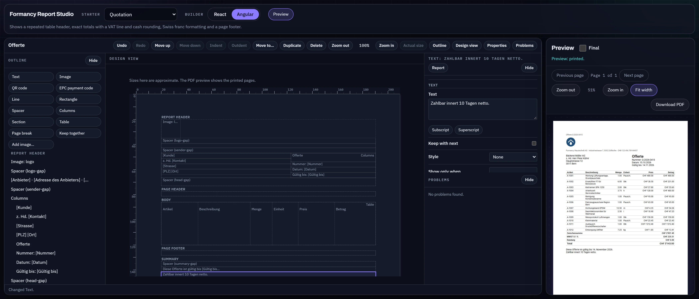

*The quotation's payment line edited in React to “Zahlbar innert 10 Tagen netto.”, then the switch moved to Angular. The Angular builder draws the same editor over the same session, so the edit is there, still selected, and so is its Undo; the Preview prints the edited line. Switching frameworks keeps the document, its history, the selection and the zoom ([0012](./docs/decisions/0012-the-builders-are-native-and-share-one-session.md)).*


*The equipment register with its Category column set to show the description instead. The builder says what that leaves behind before anything is rendered: “field "category" of the detail dataset is neither printed, drawn, ordered by, totalled nor read, and would be fetched for nothing”. A warning renders as written, so the Preview still prints the register grouped by site, with “Basel (12 items)” heading its group ([0009](./docs/decisions/0009-an-expression-is-checked-and-bound-member-by-member.md)).*


*The Book value column given the condition `row.value > 1000`, which reads a row where a column's condition has none. The builder marks it as an error, and the runtime refuses to print the preview rather than guess: “Preview: refused by the runtime, 1 problem.”, with its reason, “row has a value only in a table's cells and what an aggregate reads from each row”. Its button, “Select Book value”, pressed with Enter, selected the column and put the keyboard on its outline row, with the condition in its properties ([0010](./docs/decisions/0010-the-runtime-resolves-a-report-into-a-renderer-neutral-document.md)).*

<details>
<summary>More: At a phone's width</summary>


*At 390 pixels wide, the service inspection starter as the Studio opens. The bar's controls take a line each, and the builder shows one pane at a time, chosen from its toolbar: it opens on the Preview, standing in the design view's place, with its first page at the width there is, “Page 1 of 2” ([0029](./docs/decisions/0029-the-preview-stands-in-the-design-views-place-where-it-does-not-fit-beside-the-builder.md)). Nothing scrolls sideways, which the Studio's browser gate measures down to 320 pixels.*

</details>

Every picture in this section is taken by `node scripts/pictures.mjs`, in Chromium, from the built Studio driven through its controls, never by hand. `pnpm --filter @formancy/report-studio test:pictures` walks the same states and fails when a picture's elements no longer say what they said when it was taken, or when a caption quotes what they do not say, and `pnpm test:repo` holds every caption to its picture's record. CI runs both, in its `browser` job. Neither looks at the pixels: a change of colour or layout alone is seen only by looking. And a caption is held to the text its elements hold, not to how much of that text a pane has scrolled or cut out of the picture.

<!-- end generated -->

## What the starters print

Each starter's PDF, and each invoice sample's, printed from its synthetic
data and drawn by PDF.js. `report-render-pdf`'s `pictures.test.ts` fails
when a page stops printing or drawing what its picture shows, or its
caption quotes what the page does not print. It does not see a drawing
changed inside its own box, a rule, a border, an image or the colour of
text. The quotation, the invoices, the order confirmation, the product
data sheet, the payment reminder and the sales report print an invented
firm's mark, an SVG your application hands over like any other asset
([0032](./docs/decisions/0032-the-invoices-and-the-quotation-print-one-invented-wordless-mark-at-the-top-left-of-their-first-page.md)).

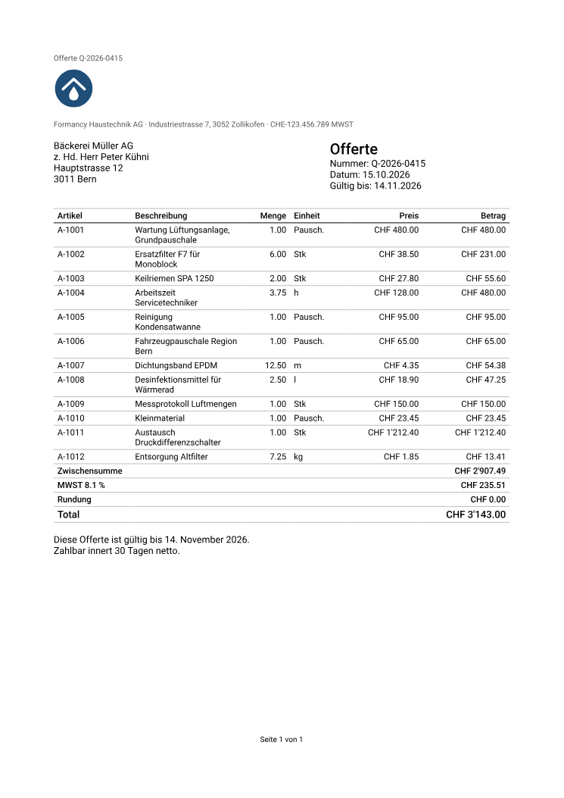

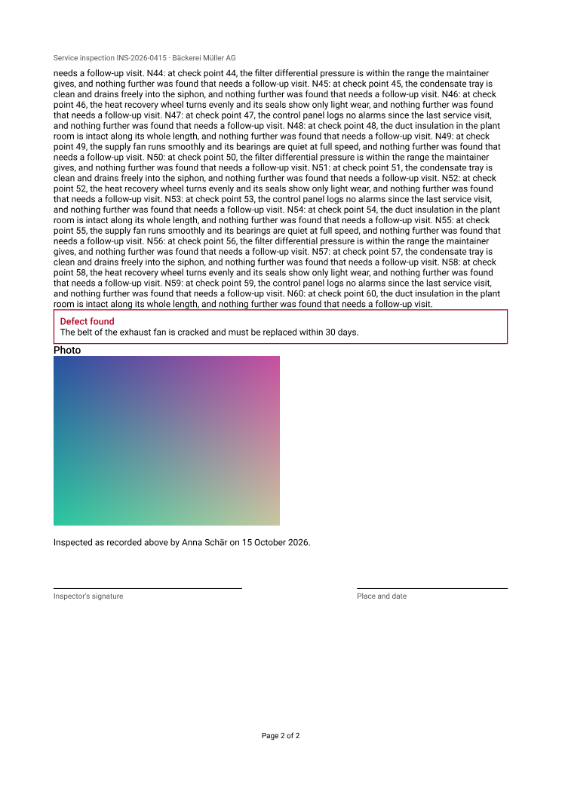

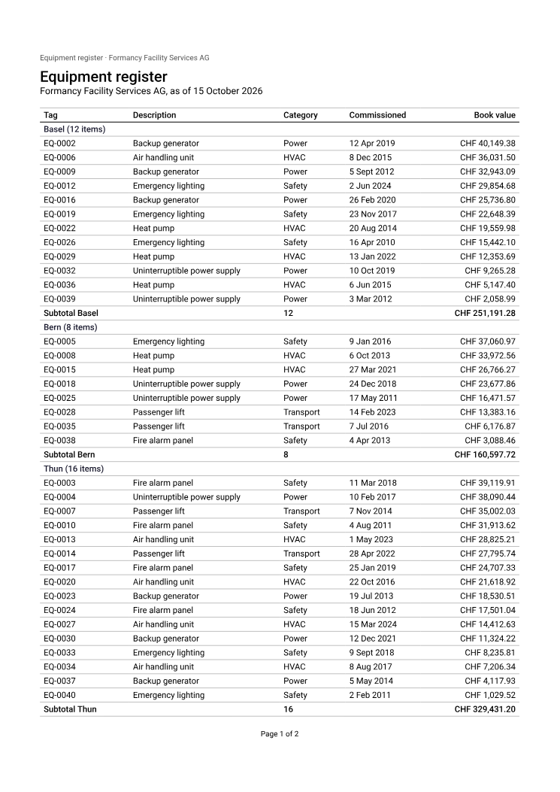

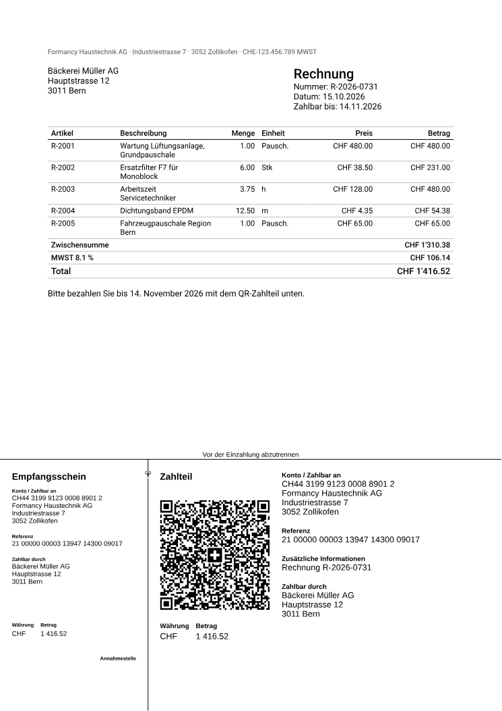

The invoice starter is in German. The same invoice comes in French,
Italian and English, with the slip's headings in SIX's words for each
([0024](./docs/decisions/0024-the-invoice-comes-in-four-languages-as-samples-and-a-qr-bill-page-shows-them.md)).

<details>
<summary>The invoice in French, Italian and English</summary>

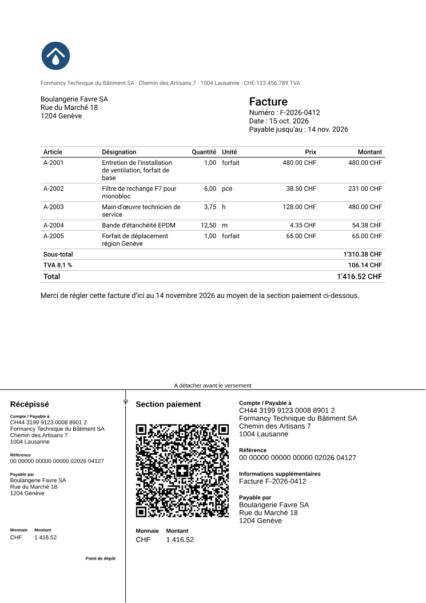

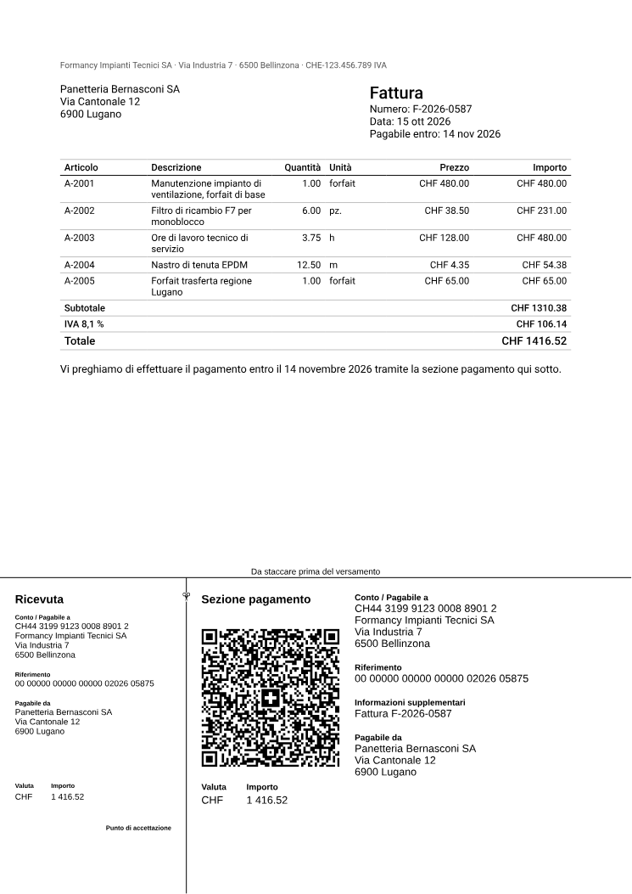


</details>


The euro invoice prints beside its EPC QR code what the code holds, for
the payer to compare with what the banking app read
([0025](./docs/decisions/0025-a-report-prints-an-epc-qr-code-held-to-the-epc-rules-beside-the-qr-bill.md)).
Samples from Austria, France, Italy, Spain, the Netherlands and Ireland
sell parts for the boiler the starter services, at each country's standard
VAT rate. No native speaker has reviewed their words, and they do not
print all that each country's invoicing law asks of an invoice
([0028](./docs/decisions/0028-the-euro-invoice-comes-as-samples-from-six-euro-countries-and-an-epc-qr-code-page-shows-them.md)).

<details>
<summary>The euro invoice from Austria, France, Italy, Spain, the Netherlands and Ireland</summary>


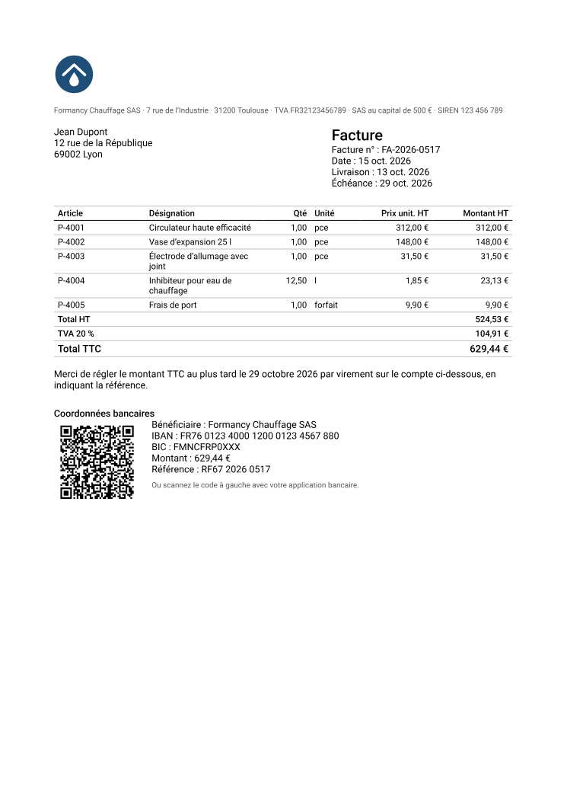


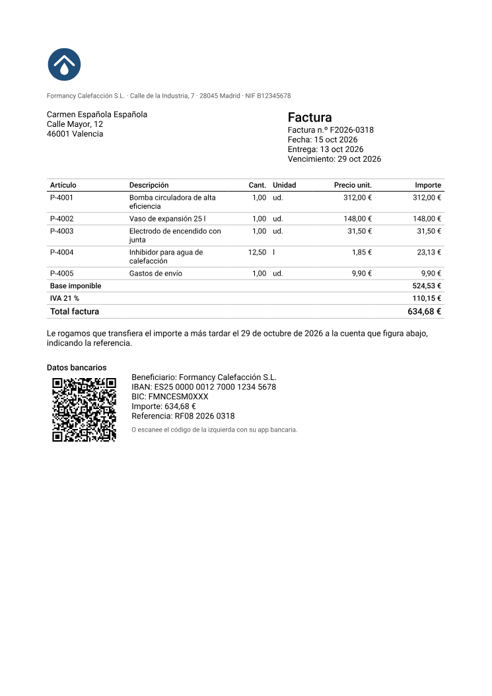

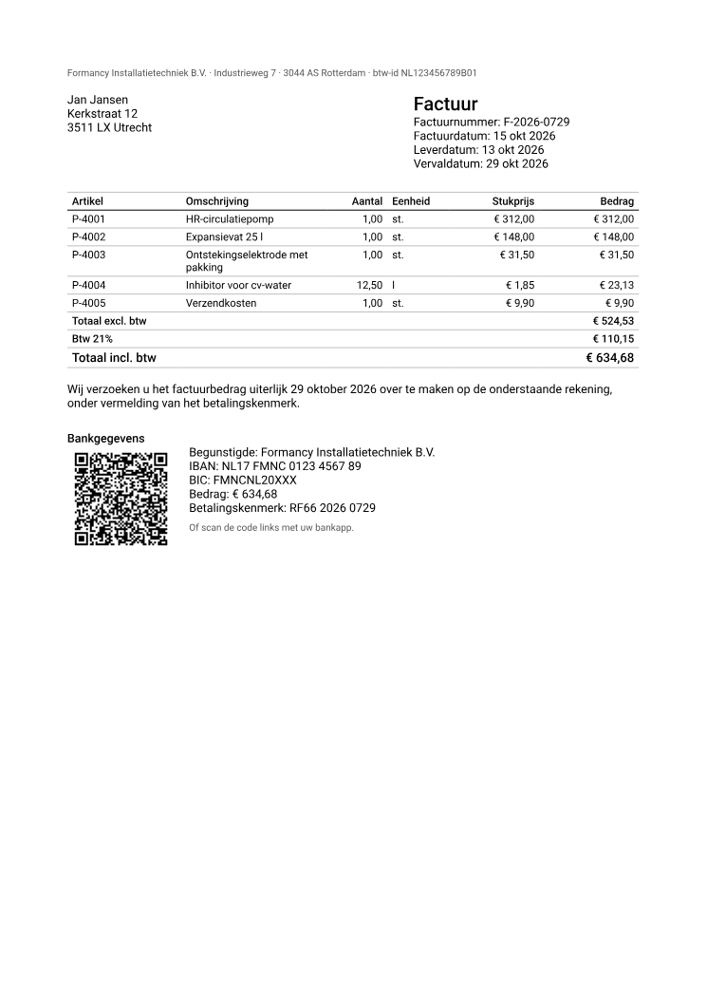

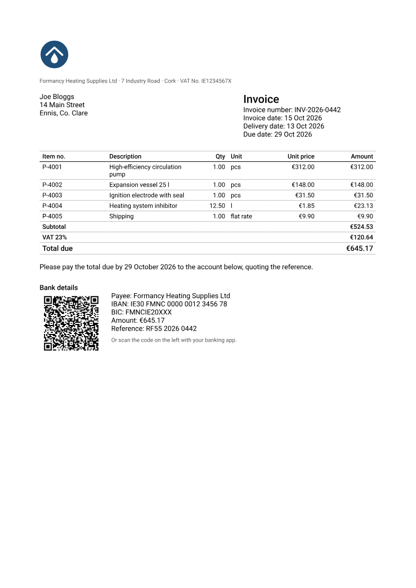

</details>


The e-invoice starter is the euro invoice's firm invoicing a German
business as an EN 16931 e-invoice, "Rechnung (ZUGFeRD)": the page prints
each total the XML holds, computed once for both
([0027](./docs/decisions/0027-a-report-carries-one-en-16931-invoice-written-from-the-values-its-page-prints.md)),
and either builder edits it field by field
([0044](./docs/decisions/0044-a-person-edits-a-reports-e-invoice-in-either-builder-one-term-a-field-in-groups.md)).
Its three other samples are the e-invoice gate's alone.

![The XRechnung starter, the e-invoice's template in the other kind, an XRechnung 3.0 billing a German public buyer of its own, whose PDF is its copy: the page headed Copy of an XRechnung: the invoice is its XML, and this PDF is not the invoice, the Leitweg-ID: 991-33333TEST-33 at the foot of its head, its line items in euro, then Nettobetrag 535,00 €, Umsatzsteuer 19 % auf 535,00 € and Rechnungsbetrag 636,65 €, the totals its XML holds, and under them the Bankverbindung beside the EPC QR code that pays it](docs/images/starter-e-invoice-xrechnung.png)

The XRechnung starter is the e-invoice's template made an XRechnung 3.0,
"Rechnung (XRechnung)", the same firm billing an invented federal office
by a Leitweg-ID from KoSIT's test suite: its XML is the invoice, and its
PDF a copy that says so on every page
([0038](./docs/decisions/0038-a-reports-e-invoice-may-be-an-xrechnung-3-0-whose-xml-a-host-takes-and-whose-pdf-is-its-labelled-copy.md)).
The Studio offers it beside the e-invoice, and a final render of either
offers its XML beside its PDF. As each starter opens, that XML is byte for
byte the file the e-invoice gate records and has Mustang and KoSIT's
validator judge, the Factur-X's in KoSIT's EN 16931 scenario and the
XRechnung's in its XRechnung scenario; the Studio's preview pipeline test
fails where the two part. Once you edit it, nothing has judged the XML you
download
([0065](./docs/decisions/0065-the-xrechnung-is-a-starter-beside-the-e-invoice-and-a-final-render-of-either-offers-its-xml-beside-its-pdf.md)).

![The site visit starter, generated from version 2 of a formancy form: a line for each answer, from Objekt: Bahnhofplatz 1, 3011 Bern, the inspector, the ticked boxes and the matrix under their headings, Elektrik: [x] among them, the findings one table under Befunde, and the page counted, 1 / 1](docs/images/starter-site-visit.png)

The site visit is the report `@formancy/report-forms` generates from a
formancy form version, a first draft: its labels from that version in the
report's language, a group a section, the repeater asked for its table,
and a submission of that version read into it. Its notes, which no page
shows, list what it left out and assumed
([0045](./docs/decisions/0045-a-report-generated-from-a-formancy-form-is-a-deterministic-first-draft-and-what-it-left-out-is-listed.md)).


The order confirmation and the product data sheet print what the report
format gained since 0.2.0
([0064](./docs/decisions/0064-an-order-confirmation-and-a-product-data-sheet-are-starters-that-print-what-0059-to-0063-added.md)).
The order confirmation is one list of order lines printed as three tables,
each picking its lines by their kind -- the goods, grouped by delivery, the
services and the returns -- each with its own columns and its own total,
and the order's total under them over every line
([0062](./docs/decisions/0062-a-report-holds-several-tables-over-its-detail-rows-each-printing-and-totalling-the-rows-its-condition-selects.md)).
Each delivery's header is kept with its first three lines, so the third
starts page 2 with them rather than at the foot of page 1
([0059](./docs/decisions/0059-a-group-header-is-kept-on-its-page-with-as-many-of-its-groups-first-rows-as-the-report-states-or-as-fit.md));
page 1 prints the firm's letterhead, and page 2 a running header with the
order's number in its place
([0060](./docs/decisions/0060-a-reports-first-page-may-print-a-header-of-its-own-or-none-in-place-of-the-page-header.md)).


The product data sheet sets its units' powers, CO₂'s index and its
footnotes' marks as runs below and above the line, never as Unicode's
small digits
([0061](./docs/decisions/0061-a-paragraphs-run-may-be-set-below-or-above-the-line-in-any-character-its-face-draws-and-prints-only-beside-a-run-on-the-line.md)).
It is written in Swiss German with its words in French, Italian and
English, and the Studio's language switch prints it in each, its values as
each locale writes them
([0063](./docs/decisions/0063-a-reports-own-words-are-written-in-each-language-it-declares-and-a-render-names-the-one-it-prints-in.md)).
The board it describes and its values are invented, and no native speaker
has reviewed its French, Italian or English.

![The payment reminder starter, a Mahnung under the firm's letterhead: the overdue invoices, each with its due date and its days overdue, down to Total überfällige Rechnungen CHF 4'773.65, the payments and the credit note received against them down to Total Zahlungen und Gutschriften CHF-1'586.35, each table totalling its own items, then Mahngebühr CHF 20.00 and Zu bezahlen CHF 3'207.30, and across the foot of the page its QR-bill, the Empfangsschein and the Zahlteil with its Swiss QR Code, each for CHF 3 207.30](docs/images/starter-payment-reminder.png)

The payment reminder is the firm's reminder of the invoices a customer has
not paid: one list of open items printed as two tables, each picking its
items by their kind, the overdue invoices with their days overdue and the
payments and the credit note received against them, each with its own
total. Under them, the reminder's fee and what is due, the balance of every
item computed once, which the QR-bill at the foot of the page asks for. It
is written in Swiss German with its words in French, Italian and English,
and a render in the customer's language prints the slip's headings in
SIX's words for it. A reminder of more invoices runs on to page 2 under a
running header, the slip at the foot of its last page. Its firm, customer
and dealings are invented, it pays SIX's example account, and no native
speaker has reviewed its French, Italian or English
([0066](./docs/decisions/0066-a-payment-reminder-is-a-starter-that-pays-the-balance-of-a-customers-overdue-invoices-by-a-qr-bill-in-the-customers-language.md)).


The sales report is the firm's month on two pages: its sales lines drawn
as a bar chart by product line and a pie by region, and printed under them
as one table grouped by product line, each group closed by its total
([0067](./docs/decisions/0067-a-monthly-sales-report-is-a-starter-whose-bar-chart-and-pie-print-the-totals-its-table-prints.md)).
Each bar's label prints the digits its product line's total prints in the
table, and each entry of the pie's legend the region's total and its share
of the month, rounded once; the runtime decides every one of those totals
once ([0055](./docs/decisions/0055-the-runtime-resolves-a-chart-exactly-its-totals-as-every-total-and-every-word-it-prints.md)),
and the renderer lays the charts out with Apache ECharts
([0058](./docs/decisions/0058-the-renderer-lays-a-chart-out-with-apache-echarts-and-prints-its-marks-and-its-words-where-echarts-placed-them.md)).
Both builders open it, draw each chart as a box and print it, and edit no
chart's own properties yet.

## Render a report

Your application resolves a report against the data it may show, then
renders it. Nothing here fetches data or follows an address: the report
names its datasets and assets, and your application hands over both. Here
`report` is the quotation starter, `data` its synthetic data and `logo` its
mark's bytes and digest, handed over when the runtime asks for it:

```ts
import { resolveReport } from '@formancy/report-runtime'
import type { ImageResolver } from '@formancy/report-runtime'
import { renderPdf, RenderRefusal } from '@formancy/report-render-pdf'

const images: ImageResolver = (ref) => (ref.asset === 'logo' && ref.digest === logo.digest ? { mediaType: 'image/svg+xml', bytes: logo.bytes } : undefined)
const resolution = resolveReport(report, data, { mode: 'final', parameters: {}, images, creationDate: '2026-10-15T08:00:00Z' })
if (!resolution.ok) throw new Error(resolution.errors.map((error) => `${error.code} at ${error.path}`).join('; '))
const pdf: Uint8Array = await renderPdf(resolution.document, { maxPages: 50 })
```

`resolveReport` refuses, with every reason at once, a report the editor's
diagnostics refuse, data that breaks its contract, an asset your
application has no bytes for (`missing-asset`) and, in a final render, incomplete data.
`renderPdf` rejects with a `RenderRefusal` whose `code` says what stopped
it: `too-many-pages`, `content-too-large`, `invalid-asset`, `cancelled` or
`unsupported`. Neither returns part of a document. The install gate runs
these lines from the packed packages (`scripts/install-fixture/consume.ts`).
With `{ maxPages: 50, pdfa: '2b' }` the same final render is a PDF/A-2b,
and a report that is an e-invoice, or a labelled preview, is refused as one
([0057](./docs/decisions/0057-a-report-that-is-no-e-invoice-is-drawn-as-a-pdf-a-2b-where-the-host-asks-for-one.md)).
`renderDocx(resolution.document)`, from `@formancy/report-render-docx`,
writes the same document as a Word file, synchronously, or throws the same
`RenderRefusal`; [its README](./packages/report-render-docx/README.md)
says what the file holds, what is Word's and what is refused; a report
that is an e-invoice is written from its copy,
`resolveReport(..., { mode: 'final', eInvoice: 'copy' })`
([0077](./docs/decisions/0077-a-report-that-carries-an-e-invoice-is-written-into-a-word-file-as-the-copy-the-runtime-labels-on-every-page.md)), and its invoice's own document is refused
([0068](./docs/decisions/0068-a-report-is-written-as-a-word-file-by-a-writer-of-its-own-and-what-belongs-to-its-pdf-is-refused.md)).

## Packages

| Package | What it is |
| --- | --- |
| [`@formancy/report-spec`](./packages/report-spec/README.md) | The report format, version 0 (a draft): its types, validation with stable error codes, a canonical hash, and the rules of a QR-bill, an EPC QR code, an e-invoice, a chart, an SVG, an image's bytes and a font's, and a report written in one of its languages ([0007](./docs/decisions/0007-a-report-definition-is-its-own-versioned-document.md), [0063](./docs/decisions/0063-a-reports-own-words-are-written-in-each-language-it-declares-and-a-render-names-the-one-it-prints-in.md)). |
| [`@formancy/report-documents`](./packages/report-documents/README.md) | The one PDF reader: a PDF's bytes read whole -- its pages, every object they draw with, and a count of what does not survive printing -- or refused, synchronously, within bounds measured at each, with no Node or DOM global; nothing calls it yet ([0054](./docs/decisions/0054-a-pdf-is-read-by-one-reader-of-its-own-which-refuses-what-it-cannot-bound.md)). |
| [`@formancy/report-core`](./packages/report-core/README.md) | Commands over a report, as functions and as data, several as one batch, a session that commits only what validates, with exact undo and redo, and one compilation of every expression for the diagnostics and the runtime ([0008](./docs/decisions/0008-edits-are-commands-and-a-refused-edit-changes-nothing.md), [0009](./docs/decisions/0009-an-expression-is-checked-and-bound-member-by-member.md), [0048](./docs/decisions/0048-a-form-version-that-removes-moves-or-retypes-a-field-a-report-reads-blocks-that-reports-submissions-of-it-until-reviewed-anything-else-prints.md)). |
| [`@formancy/report-runtime`](./packages/report-runtime/README.md) | Resolves a report against its data into a renderer-neutral document, exact numbers as strings and totals rounded once, and writes an e-invoice's XML, or refuses with every reason; its manifest says what a render was resolved from, the data's source among it; and it holds the one rule every engine draws a QR code's symbol by, and refuses one by ([0010](./docs/decisions/0010-the-runtime-resolves-a-report-into-a-renderer-neutral-document.md), [0041](./docs/decisions/0041-a-renders-manifest-names-where-its-data-came-from-by-identifiers-alone.md), [0074](./docs/decisions/0074-a-qr-code-and-an-epc-qr-code-are-written-into-a-word-file-and-what-refuses-a-code-stands-below-both-engines.md)). |
| [`@formancy/report-render-pdf`](./packages/report-render-pdf/README.md) | Draws that document with pdfmake, in Node and through a browser entry, and refuses what it cannot draw whole rather than return a partial PDF ([0005](./docs/decisions/0005-pdfmake-renders-reports-behind-one-adapter.md), [0011](./docs/decisions/0011-report-render-pdf-draws-the-document-and-refuses-what-it-cannot.md)). |
| [`@formancy/report-render-docx`](./packages/report-render-docx/README.md) | Writes that document as a Word file a person can go on writing in, the same bytes for the same document, with no Node or DOM global, a QR code and an EPC QR code as pictures of the symbol the PDF draws and a chart as Word's own chart, a QR-bill's slip on a page of its own and an e-invoice as the copy the runtime labels, and refuses what belongs to the report's PDF rather than leave it out ([0077](./docs/decisions/0077-a-report-that-carries-an-e-invoice-is-written-into-a-word-file-as-the-copy-the-runtime-labels-on-every-page.md), [0068](./docs/decisions/0068-a-report-is-written-as-a-word-file-by-a-writer-of-its-own-and-what-belongs-to-its-pdf-is-refused.md), [0074](./docs/decisions/0074-a-qr-code-and-an-epc-qr-code-are-written-into-a-word-file-and-what-refuses-a-code-stands-below-both-engines.md), [0076](./docs/decisions/0076-a-chart-is-written-into-a-word-file-as-words-own-chart-from-the-runtimes-block-and-no-workbook.md)). |
| [`@formancy/report-data-provider`](./packages/report-data-provider/README.md) | Reads a report's data from a Formancy Data 0.1.0 server, labelled best-effort ([0016](./docs/decisions/0016-the-data-provider-reads-formancy-data-0-1-0-best-effort.md)). |
| [`@formancy/report-forms`](./packages/report-forms/README.md) | Reads a report's data from a formancy form's submissions, against the exact version that collected each, as your application hands them over, host-captured ([0042](./docs/decisions/0042-a-report-reads-a-formancy-forms-submissions-against-the-exact-version-that-collected-them-as-the-host-hands-them-over.md)); and starts a report from a form version, a first draft whose notes list what it left out ([0045](./docs/decisions/0045-a-report-generated-from-a-formancy-form-is-a-deterministic-first-draft-and-what-it-left-out-is-listed.md)); and reviews a form's new version for a report, a version that moved, removed or retyped a field it reads blocking until a resolution -- a declared rename first, report-core's commands as data -- is applied ([0048](./docs/decisions/0048-a-form-version-that-removes-moves-or-retypes-a-field-a-report-reads-blocks-that-reports-submissions-of-it-until-reviewed-anything-else-prints.md)). |
| [`@formancy/report-server-core`](./packages/report-server-core/README.md) | Who may do what to a tenant's reports, as one actions table over the host's verified identity, the wire a client compiles against, the audit port, and the use cases that decide a tenant's drafts and images over a store's port; no framework and no Node ([0046](./docs/decisions/0046-report-has-a-server-of-its-own-over-the-hosts-verified-identity.md), [0049](./docs/decisions/0049-a-templates-draft-is-kept-by-the-report-server-one-per-tenant-saved-by-compare-and-swap.md)). |
| [`@formancy/report-server`](./packages/report-server/README.md) | The server, on Fastify: your application's token verified offline by Formancy Data's verifier, the tenant from a required claim, `/health`, `/v1/whoami` and a template's draft and its images, in files on one volume, and nothing else; its settings read once, and its image built from the repository ([0046](./docs/decisions/0046-report-has-a-server-of-its-own-over-the-hosts-verified-identity.md), [0047](./docs/decisions/0047-report-server-verifies-the-hosts-token-with-formancy-datas-data-identity-0-3-0.md), [0049](./docs/decisions/0049-a-templates-draft-is-kept-by-the-report-server-one-per-tenant-saved-by-compare-and-swap.md)). |
| [`@formancy/report-client`](./packages/report-client/README.md) | What your page asks that server with: the tenant's templates, a draft read and saved from its version, an image kept and read by its digest, each refusal answered with its code, over the fetch and the token your page gives it; no framework and no Node ([0049](./docs/decisions/0049-a-templates-draft-is-kept-by-the-report-server-one-per-tenant-saved-by-compare-and-swap.md)). |
| [`@formancy/report-builder-core`](./packages/report-builder-core/README.md) | The editor model both builders render, with no framework, in English, Swiss German and Swiss French; `BUILDER_SCENARIOS` is what every builder must do ([0012](./docs/decisions/0012-the-builders-are-native-and-share-one-session.md)). |
| [`@formancy/report-builder-react`](./packages/report-builder-react/README.md) | The builder for React 19. |
| [`@formancy/report-builder-angular`](./packages/report-builder-angular/README.md) | The builder for Angular 22: standalone components, signals and `OnPush`, no zone.js. |

Beside them, `apps/studio` is [the Studio](#the-studio), `apps/pages` the
product's pages, static HTML in four languages
([0021](./docs/decisions/0021-the-product-pages-are-static-html-in-four-languages-beside-the-studio.md)),
and `@formancy/report-corpus` the private test support that proves a
rendered PDF
([0003](./docs/decisions/0003-a-rendered-report-is-proved-on-the-pdf-it-produced.md))
and reads a written Word file back (0068), a code in it from the
pixels of its picture (0074) and a chart in it from its part (0076);
none is published.

## Licence, in one table

Source-available, **not** open source. The formancy packages this module
builds on stay Apache-2.0; this module does not. It is on Formancy Data's
terms.

| Use | Terms |
| --- | --- |
| Read the source and fork the repository | Free |
| Evaluate, develop and test — including in companies | Free |
| Run in production, internally or customer-facing | Paid licence |
| Redistribute inside another software product | Separate commercial agreement |
| Customer data, report templates and generated documents | Remain the customer's |

<!-- generated by scripts/licence-status.mjs from LICENSE.md; do not edit -->

[`LICENSE.md`](./LICENSE.md) has the terms. It is Version 1, in force from 14 October 2026, and says at the top that no lawyer has reviewed it. A production licence is requested from [info@formancy.ai](mailto:info@formancy.ai), as its section 9 says.

<!-- end generated -->

Why a paid module exists beside an Apache-2.0 project is decision
[0001](./docs/decisions/0001-a-paid-module-in-its-own-repository.md).
Running `@formancy/report-data-provider` in production needs a Formancy
Data production licence as well, for the `@formancy/data-client` it
depends on
([0016](./docs/decisions/0016-the-data-provider-reads-formancy-data-0-1-0-best-effort.md)).

## How it relates to formancy.ai and Formancy Data

Report depends on the released `@formancy/*` packages at exact versions and
copies none of their code
([0002](./docs/decisions/0002-depend-on-upstream-never-copy-it.md)). A
report is its own document, with pages, flowing tables, groups and totals,
not a widened formancy form
([0007](./docs/decisions/0007-a-report-definition-is-its-own-versioned-document.md)).
Formancy Data is optional: without it, your application supplies the data.
With it, one package reads a published Data form's records, as the person
whose token your application supplies, so Data's policy decides every answer
([0016](./docs/decisions/0016-the-data-provider-reads-formancy-data-0-1-0-best-effort.md)).
Data never depends on Report. The report server verifies your
application's token with Data's identity verifier,
`@formancy/data-identity`, and reads nothing else of Data, so running it in
production needs a Data licence too; it keeps its drafts in files of its
own, never in Data
([0047](./docs/decisions/0047-report-server-verifies-the-hosts-token-with-formancy-datas-data-identity-0-3-0.md)). A formancy form's submissions are read
through `@formancy/spec`'s own validator, hash and labels, along scopes a
test holds to formancy's own data paths, by a package that depends on
formancy alone, never on Data
([0042](./docs/decisions/0042-a-report-reads-a-formancy-forms-submissions-against-the-exact-version-that-collected-them-as-the-host-hands-them-over.md)).

## Development

Node 22.13 or later, which `pdfjs-dist` 6.4 needs, and pnpm through corepack.

```bash
corepack enable pnpm
pnpm install
pnpm build
pnpm test
pnpm lint        # after pnpm build: the type-aware rules read the built declarations
pnpm format      # Prettier, over every TypeScript and JavaScript file, twice before committing: it is not idempotent on some member chains
```

CI fails a TypeScript or JavaScript file that breaks a lint rule or that
Prettier would write otherwise; the rules and the style are the four
formancy repositories' shared ones, `@formancy/code-style`, which
formancy.ai releases and this repository pins exactly
([0050](./docs/decisions/0050-every-typescript-and-javascript-file-is-linted-and-formatted-by-the-rules-the-four-repositories-share.md)).
A branch begun before the format takes `main` through
`scripts/prettier-merge.mjs`, as
[`CONTRIBUTING.md`](./CONTRIBUTING.md#a-branch-begun-before-the-format)
says.

While working on the Studio, `pnpm --filter @formancy/report-studio dev`
serves it on port 4394, once `pnpm build` has built the packages it
imports. `node scripts/container.mjs` builds the server's image and runs
the container gate's checks on it, with Docker; the server's settings are
in [its README](./packages/report-server/README.md#settings).
`pnpm --filter @formancy/report-pages test:browser`, after `pnpm build`
and the Studio's `playwright install chromium`, measures every page of the
built sitemap in Chromium, served under `/report/` with the demo's
headers, as CI's `browser` job does
([0053](./docs/decisions/0053-the-product-pages-are-measured-in-chromium-by-a-browser-gate-of-their-own.md)).

CI runs the gates of `.github/workflows/gates.yml` on every pull request,
and a release runs them before it publishes. Every run ends in a release
report of what it was tested on and what it found, and a release publishes
only what its own run's report passed
([0014](./docs/decisions/0014-a-release-report-is-derived-from-the-run-that-gated-it.md)).
[`CLAUDE.md`](./CLAUDE.md) gives each gate's command and the bar a change
meets; [Verification](./docs/architecture/10-verification.md) says what each
gate proves and what it does not.

### What it is tested with

<!-- generated by scripts/release-report/readme.mjs; do not edit -->

| | Tested with | Declared as |
| --- | --- | --- |
| `@formancy/data-client` | 0.1.0 | `0.1.0` |
| `@formancy/data-core` (transitive) | 0.1.0 |  |
| `@formancy/data-identity` | 0.3.0 | `0.3.0` |
| `@formancy/expressions` | 0.12.0 | `0.12.0` |
| `@formancy/spec` | 0.12.0 | `0.12.0` |
| `@formancy/spec` (transitive) | 0.5.0 |  |
| `@formancy/themes` | 0.12.0 | `0.12.0` |
| `tslib`, by `@formancy/report-builder-angular` | 2.8.1 | `^2.8.0` |
| `@pdfme/pdf-lib`, by `@formancy/report-documents` | 6.2.4 | `6.2.4` |
| `pako`, by `@formancy/report-documents` | 3.0.2 | `3.0.2` |
| `fflate`, by `@formancy/report-render-docx` | 0.8.3 | `0.8.3` |
| `pako`, by `@formancy/report-render-docx` | 3.0.2 | `3.0.2` |
| `echarts`, by `@formancy/report-render-pdf` | 6.1.0 | `6.1.0` |
| `pdfkit`, by `@formancy/report-render-pdf` | 0.19.1 | `0.19.1` |
| `pdfmake`, by `@formancy/report-render-pdf` | 0.3.11 | `0.3.11` |
| `zrender`, by `@formancy/report-render-pdf` | 6.1.0 | `6.1.0` |
| `uqr`, by `@formancy/report-runtime` | 0.1.3 | `0.1.3` |
| `@fastify/rate-limit`, by `@formancy/report-server` | 11.2.1 | `11.2.1` |
| `fastify`, by `@formancy/report-server` | 5.12.7 | `5.12.7` |
| `@noble/hashes`, by `@formancy/report-spec` | 2.4.0 | `2.4.0` |
| `@angular/core`, a peer of `@formancy/report-builder-angular` | 22.2.2, in its suites | `^22.0.0` |
| `react`, a peer of `@formancy/report-builder-react` | 19.3.1, in its suites | `^19.0.0` |
| `react-dom`, a peer of `@formancy/report-builder-react` | 19.3.1, in its suites | `^19.0.0` |
| Node, the workspace |  | `>=22.13.0` |
| Node, CI | 22 |  |
| pnpm | 12.4.2, through corepack | `pnpm@12.4.2`, the root's `packageManager` |
| Chromium | 156.0.8078.4, the chromium-headless-shell Playwright 1.64.1 pins (revision 1248) |  |
| `typescript` | 6.0.3 | `~6.0.3` |
| `vitest` | 5.0.4 | `^5.0.1` |
| `pdfjs-dist` | 6.4.299 | `6.4.299` |
| `jsdom` | 30.1.2 |  |
| `axe-core` | 4.14.0 |  |
| `playwright` | 1.64.1 | `^1.63.0` |

What a run actually ran -- the Node of each job, the React and Angular each install host resolved at both ends of the builders’ peer ranges, and the Chromium the browser gates launched -- is in the release report every CI run produces and every release attaches, signed.

<!-- end generated -->

## Documents

- [`docs/getting-started.md`](./docs/getting-started.md) — from an empty npm project to a PDF and the editor in your page, its code compiled and run by the install gate.
- [`docs/README.md`](./docs/README.md) — the architecture, in arc42's sections.
- [`docs/decisions/`](./docs/decisions/README.md) — every decision somebody could helpfully undo, with what verifies it.
- [`CHANGELOG.md`](./CHANGELOG.md) — what changed and why.
- [`CONTRIBUTING.md`](./CONTRIBUTING.md) and [`CLA.md`](./CLA.md) — contributions are taken under a CLA, checked on every pull request.
- [`SECURITY.md`](./SECURITY.md) — how to report a vulnerability.
- [`RELEASING.md`](./RELEASING.md) — how a release is cut, with provenance, a signed SBOM and the signed release report.
- [`docs/release/`](./docs/release/README.md) — what the release report holds and what fails it, with the release gates and the known limitations.
