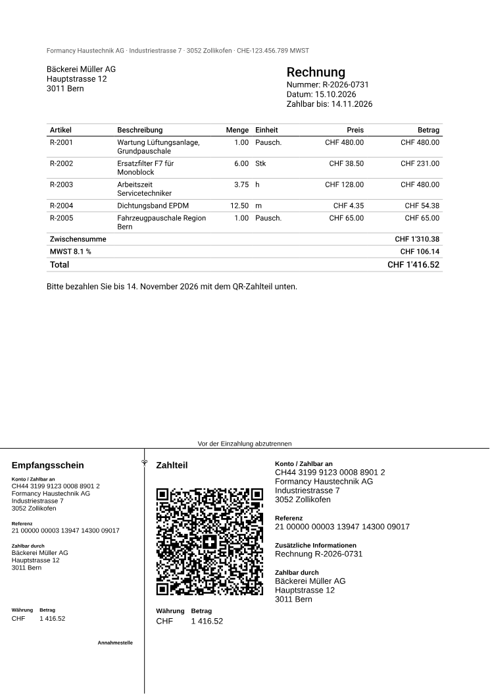
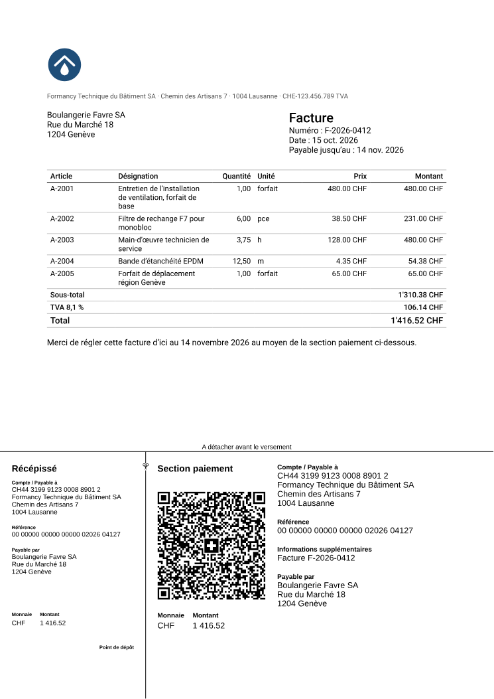
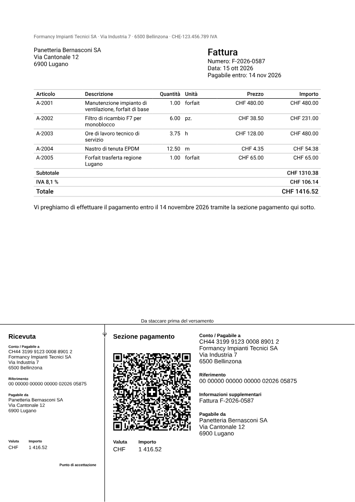
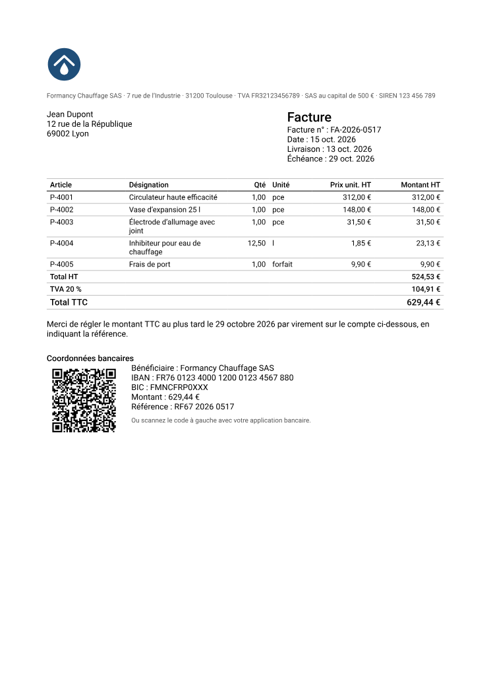
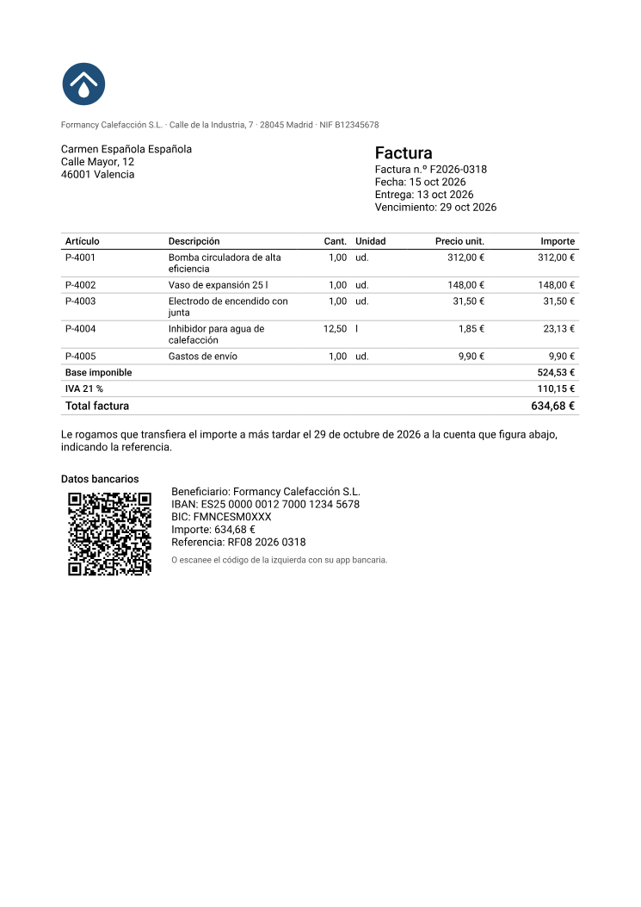
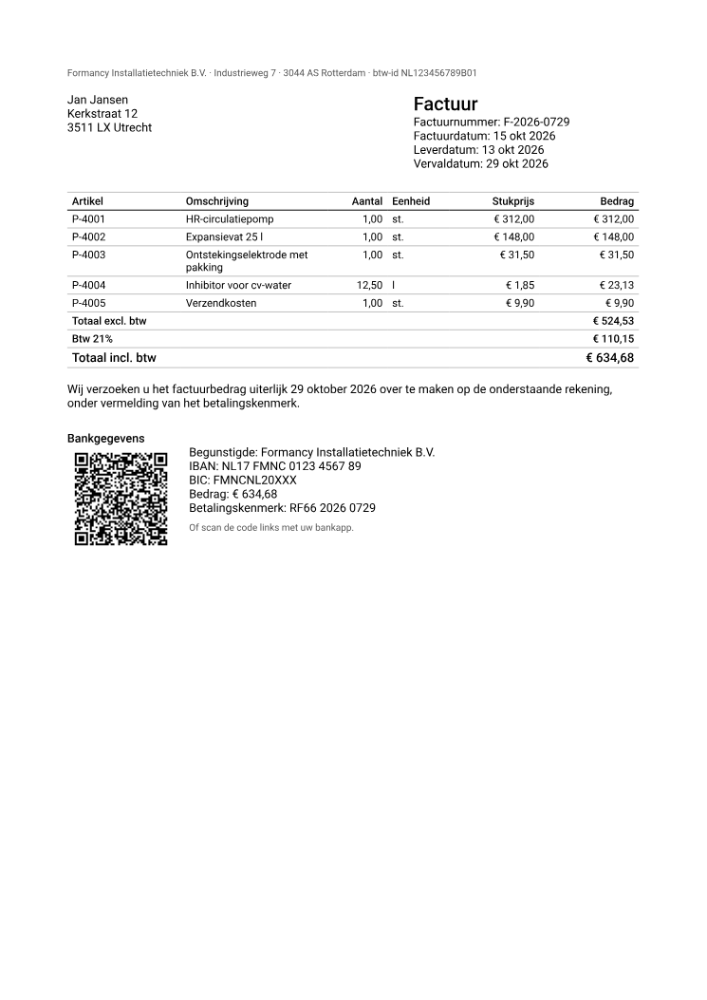
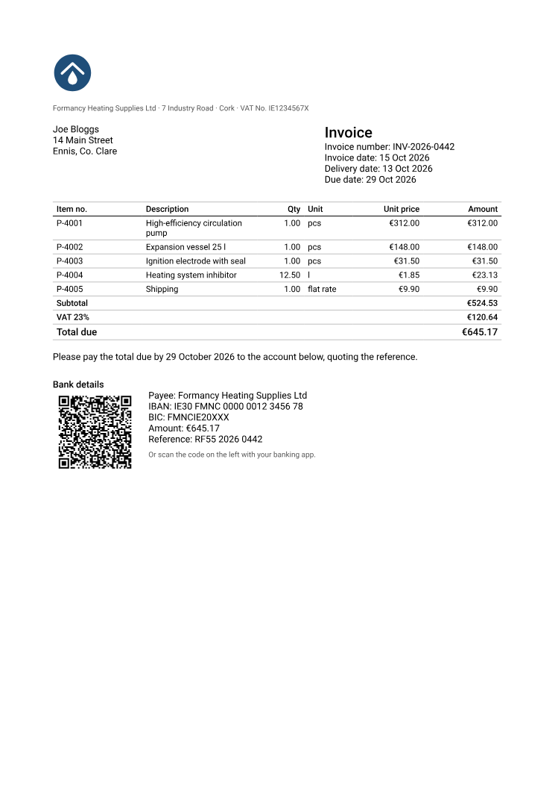

# Formancy Report

**Paginated PDF reports, designed inside your Angular or React application.**

Formancy Report is a paid, [source-available](#licence-in-one-table) module
that designs and renders paginated PDF reports. It builds on the Apache-2.0
[formancy](https://github.com/sharkysan/formancy.ai) packages and runs in
your application: you host it, and you hand it the data.

<!-- generated by scripts/pictures/readme.mjs from scripts/pictures/scenes.json: hero; do not edit -->


*The quotation starter in the React builder, and beside it the Preview: the PDF the runtime and the renderer print from the same session, drawn by PDF.js on white paper, down to “Total CHF 3'143.00” ([0010](./docs/decisions/0010-the-runtime-resolves-a-report-into-a-renderer-neutral-document.md), [0011](./docs/decisions/0011-report-render-pdf-draws-the-document-and-refuses-what-it-cannot.md)).*

Taken by a script from the built Studio and held to the text it shows, as every picture under [The Studio](#the-studio) is.

<!-- end generated -->

## What it does

- **Design a report** in a native React or Angular builder, with undo, and see what is wrong before anything renders ([0012](./docs/decisions/0012-the-builders-are-native-and-share-one-session.md), [0009](./docs/decisions/0009-an-expression-is-checked-and-bound-member-by-member.md)).
- **Print it as a paginated PDF**, in Node or in a browser, from your application's JSON. Totals are exact, values are formatted for the report's locale, and a report that cannot be drawn whole is refused, never truncated ([0010](./docs/decisions/0010-the-runtime-resolves-a-report-into-a-renderer-neutral-document.md), [0011](./docs/decisions/0011-report-render-pdf-draws-the-document-and-refuses-what-it-cannot.md)).
- **Read its data from [Formancy Data](https://github.com/sharkysan/formancy.ai-data) 0.1.0**, optionally and best-effort ([0016](./docs/decisions/0016-the-data-provider-reads-formancy-data-0-1-0-best-effort.md)).
- **Say where a render's data came from**, in the manifest kept beside the PDF: the Data forms it read, or each submission of a formancy form with its form's id and the version that collected it, held to the syntax of identifiers ([0041](./docs/decisions/0041-a-renders-manifest-names-where-its-data-came-from-by-identifiers-alone.md)).
- **QR codes**, refused where they may not scan ([0020](./docs/decisions/0020-a-qr-code-is-drawn-from-its-own-matrix-and-refused-where-it-may-not-scan.md)).
- **A Swiss QR-bill**, its receipt and payment part at the foot of the last page, held to SIX's rules ([0022](./docs/decisions/0022-a-report-carries-one-swiss-qr-bill-at-the-foot-of-its-last-page.md)).
- **An EPC QR code** for a SEPA credit transfer, held to the EPC's rules, with Austria's frame as an option ([0025](./docs/decisions/0025-a-report-prints-an-epc-qr-code-held-to-the-epc-rules-beside-the-qr-bill.md)).
- **An EN 16931 e-invoice**, the German hybrid invoice: the Factur-X / ZUGFeRD XML is written from the values the page prints, and a final render is a PDF/A-3b that embeds it. It may name the parties' electronic addresses, the seller's contact and its business process, which a German business invoice does not need. Or it is an **XRechnung 3.0** for a German public buyer, in CII: its XML, which your application takes from the resolved document and sends, is the invoice, and its PDF a copy labelled so on every page. France is not claimed. In a gate of its own, Mustang and KoSIT judge the XML of the repository's samples, an XRechnung's in KoSIT's XRechnung scenario, and veraPDF and Mustang the hybrids' PDFs ([0027](./docs/decisions/0027-a-report-carries-one-en-16931-invoice-written-from-the-values-its-page-prints.md), [0031](./docs/decisions/0031-an-e-invoice-is-drawn-as-a-pdf-a-3b-that-embeds-its-xml.md), [0037](./docs/decisions/0037-an-e-invoice-may-name-electronic-addresses-the-sellers-contact-and-its-business-process-none-needed-for-german-b2b.md), [0038](./docs/decisions/0038-a-reports-e-invoice-may-be-an-xrechnung-3-0-whose-xml-a-host-takes-and-whose-pdf-is-its-labelled-copy.md)).
- **Images**: a PNG, a JPEG, or an SVG logo drawn as vectors, made of shapes alone: no text, no embedded picture. Where your application gives the editor a store for them, a person adds one in either builder, and your application keeps its bytes ([0030](./docs/decisions/0030-an-image-asset-may-be-an-svg-of-drawing-elements-alone-cleaned-once-and-refused-at-print-in-any-other-form.md), [0033](./docs/decisions/0033-a-person-adds-an-image-in-either-builder-and-the-host-keeps-its-bytes.md)).
- **The Studio**, a playground with both builders and the PDF they print, beside them or in the design view's place, online at https://formancy.ai/report/ ([Try it](#try-it), [0018](./docs/decisions/0018-the-studio-demo-is-served-at-formancy-ai-report.md)).

Planned and not here: the server and its jobs, reviewed AI changes, a
published PDF viewer, and a consistent read from Formancy Data.

> **Status, 19 October 2026: 0.2.0, a developer preview, is released.**
> Its eight packages are on npm, with provenance, and
> [the GitHub release](https://github.com/sharkysan/formancy.ai-report/releases/tag/v0.2.0)
> carries the signed SBOM and release report of the run that published
> them. What 0.2.0 holds and leaves out is in
> [the changelog](./CHANGELOG.md#020--2026-10-19). The report format is
> still version "0", the draft: a report written now is not promised to be
> read by a later release
> ([0004](./docs/decisions/0004-three-version-lines-each-refused-when-unknown.md)).

**Start with [the getting-started guide](./docs/getting-started.md)**: a
quotation printed as a PDF in Node and in a browser, an XRechnung's XML
taken from what the runtime resolved, the editor in a React page that saves
and previews, and in an Angular page. The install gate
compiles and runs its code against the packed packages
([0015](./docs/decisions/0015-the-getting-started-guide-is-compiled-and-run-by-the-install-gate.md)).

## Try it

The Studio is online at https://formancy.ai/report/, and runs from a clone
with Node 22.13 or later and corepack:

```bash
git clone https://github.com/sharkysan/formancy.ai-report.git
cd formancy.ai-report
corepack enable pnpm
pnpm install
pnpm demo
```

`pnpm demo` builds the packages and the Studio, then serves the built
Studio at http://localhost:4394. Pick a starter or a blank report, edit it
in either builder, and the Preview prints the PDF, Download PDF included.
The starters' data is synthetic and built in. The page asks no other site
for anything, and the browser gate fails if it does
([0023](./docs/decisions/0023-the-studio-and-the-pages-serve-their-own-faces-and-ask-no-other-site-for-anything.md)).

The online Studio is `main`'s, deployed on every push to `main`, so it can
be ahead of the latest release. Nothing here checks what the address serves
([RELEASING.md](./RELEASING.md#the-demo-on-formancyai)). The product's
pages stand beside it, from https://formancy.ai/report/en/.

## The Studio

`apps/studio` is the playground, never published as a package
([0013](./docs/decisions/0013-the-studio-is-the-same-room-and-its-pictures-are-taken-by-a-script.md)).
The Preview stands beside the builder where the window has room for it,
and in the design view's place where it has not
([0029](./docs/decisions/0029-the-preview-stands-in-the-design-views-place-where-it-does-not-fit-beside-the-builder.md)).
Add image… adds a PNG, a JPEG or an SVG from your computer, kept in the
page and sent nowhere
([0033](./docs/decisions/0033-a-person-adds-an-image-in-either-builder-and-the-host-keeps-its-bytes.md)).

<!-- generated by scripts/pictures/readme.mjs from scripts/pictures/scenes.json: studio; do not edit -->


*The quotation's payment line edited in React to “Zahlbar innert 10 Tagen netto.”, then the switch moved to Angular. The Angular builder draws the same editor over the same session, so the edit is there, still selected, and so is its Undo; the Preview prints the edited line. Switching frameworks keeps the document, its history, the selection and the zoom ([0012](./docs/decisions/0012-the-builders-are-native-and-share-one-session.md)).*


*The equipment register with its Category column set to show the description instead. The builder says what that leaves behind before anything is rendered: “field "category" of the detail dataset is neither printed, drawn, ordered by, totalled nor read, and would be fetched for nothing”. A warning renders as written, so the Preview still prints the register grouped by site, with “Basel (12 items)” heading its group ([0009](./docs/decisions/0009-an-expression-is-checked-and-bound-member-by-member.md)).*


*The Book value column given the condition `row.value > 1000`, which reads a row where a column's condition has none. The builder marks it as an error, and the runtime refuses to print the preview rather than guess: “Preview: refused by the runtime, 1 problem.”, with its reason, “row has a value only in a table's cells and what an aggregate reads from each row”. Its button, “Select Book value”, pressed with Enter, selected the column and put the keyboard on its outline row, with the condition in its properties ([0010](./docs/decisions/0010-the-runtime-resolves-a-report-into-a-renderer-neutral-document.md)).*

<details>
<summary>More: At a phone's width</summary>


*At 390 pixels wide, the service inspection starter as the Studio opens. The bar's controls take a line each, and the builder shows one pane at a time, chosen from its toolbar: it opens on the Preview, standing in the design view's place, with its first page at the width there is, “Page 1 of 2” ([0029](./docs/decisions/0029-the-preview-stands-in-the-design-views-place-where-it-does-not-fit-beside-the-builder.md)). Nothing scrolls sideways, which the Studio's browser gate measures down to 320 pixels.*

</details>

Every picture in this section is taken by `node scripts/pictures.mjs`, in Chromium, from the built Studio driven through its controls, never by hand. `pnpm --filter @formancy/report-studio test:pictures` walks the same states and fails when a picture's elements no longer say what they said when it was taken, or when a caption quotes what they do not say, and `pnpm test:repo` holds every caption to its picture's record. CI runs both, in its `browser` job. Neither looks at the pixels: a change of colour or layout alone is seen only by looking. And a caption is held to the text its elements hold, not to how much of that text a pane has scrolled or cut out of the picture.

<!-- end generated -->

## What the starters print

Each starter's PDF, and each invoice sample's, printed from its synthetic
data and drawn by PDF.js. `report-render-pdf`'s `pictures.test.ts` fails
when a page stops printing or drawing what its picture shows, or its
caption quotes what the page does not print. It does not see a drawing
changed inside its own box, a rule, a border, an image or the colour of
text. The quotation and the invoices print an invented firm's mark, an SVG
your application hands over like any other asset
([0032](./docs/decisions/0032-the-invoices-and-the-quotation-print-one-invented-wordless-mark-at-the-top-left-of-their-first-page.md)).




The invoice starter is in German. The same invoice comes in French,
Italian and English, with the slip's headings in SIX's words for each
([0024](./docs/decisions/0024-the-invoice-comes-in-four-languages-as-samples-and-a-qr-bill-page-shows-them.md)).

<details>
<summary>The invoice in French, Italian and English</summary>






</details>


The euro invoice prints beside its EPC QR code what the code holds, for
the payer to compare with what the banking app read
([0025](./docs/decisions/0025-a-report-prints-an-epc-qr-code-held-to-the-epc-rules-beside-the-qr-bill.md)).
Samples from Austria, France, Italy, Spain, the Netherlands and Ireland
sell parts for the boiler the starter services, at each country's standard
VAT rate. No native speaker has reviewed their words, and they do not
print all that each country's invoicing law asks of an invoice
([0028](./docs/decisions/0028-the-euro-invoice-comes-as-samples-from-six-euro-countries-and-an-epc-qr-code-page-shows-them.md)).

<details>
<summary>The euro invoice from Austria, France, Italy, Spain, the Netherlands and Ireland</summary>











</details>

## Render a report

Your application resolves a report against the data it may show, then
renders it. Nothing here fetches data or follows an address: the report
names its datasets and assets, and your application hands over both. Here
`report` is the quotation starter, `data` its synthetic data and `logo` its
mark's bytes and digest, handed over when the runtime asks for it:

```ts
import { resolveReport } from '@formancy/report-runtime'
import type { ImageResolver } from '@formancy/report-runtime'
import { renderPdf, RenderRefusal } from '@formancy/report-render-pdf'

const images: ImageResolver = (ref) => (ref.asset === 'logo' && ref.digest === logo.digest ? { mediaType: 'image/svg+xml', bytes: logo.bytes } : undefined)
const resolution = resolveReport(report, data, { mode: 'final', parameters: {}, images, creationDate: '2026-10-15T08:00:00Z' })
if (!resolution.ok) throw new Error(resolution.errors.map((error) => `${error.code} at ${error.path}`).join('; '))
const pdf: Uint8Array = await renderPdf(resolution.document, { maxPages: 50 })
```

`resolveReport` refuses, with every reason at once, a report the editor's
diagnostics refuse, data that breaks its contract, an asset your
application has no bytes for (`missing-asset`) and, in a final render, incomplete data.
`renderPdf` rejects with a `RenderRefusal` whose `code` says what stopped
it: `too-many-pages`, `content-too-large`, `invalid-asset`, `cancelled` or
`unsupported`. Neither returns part of a document. The install gate runs
these lines from the packed packages (`scripts/install-fixture/consume.ts`).

## Packages

| Package | What it is |
| --- | --- |
| [`@formancy/report-spec`](./packages/report-spec/README.md) | The report format, version 0 (a draft): its types, validation with stable error codes, a canonical hash, and the rules of a QR-bill, an EPC QR code, an e-invoice, an SVG and an image's bytes ([0007](./docs/decisions/0007-a-report-definition-is-its-own-versioned-document.md)). |
| [`@formancy/report-core`](./packages/report-core/README.md) | Commands over a report, a session that commits only what validates, with exact undo and redo, and one compilation of every expression for the diagnostics and the runtime ([0008](./docs/decisions/0008-edits-are-commands-and-a-refused-edit-changes-nothing.md), [0009](./docs/decisions/0009-an-expression-is-checked-and-bound-member-by-member.md)). |
| [`@formancy/report-runtime`](./packages/report-runtime/README.md) | Resolves a report against its data into a renderer-neutral document, exact numbers as strings and totals rounded once, and writes an e-invoice's XML, or refuses with every reason; its manifest says what a render was resolved from, the data's source among it ([0010](./docs/decisions/0010-the-runtime-resolves-a-report-into-a-renderer-neutral-document.md), [0041](./docs/decisions/0041-a-renders-manifest-names-where-its-data-came-from-by-identifiers-alone.md)). |
| [`@formancy/report-render-pdf`](./packages/report-render-pdf/README.md) | Draws that document with pdfmake, in Node and through a browser entry, and refuses what it cannot draw whole rather than return a partial PDF ([0005](./docs/decisions/0005-pdfmake-renders-reports-behind-one-adapter.md), [0011](./docs/decisions/0011-report-render-pdf-draws-the-document-and-refuses-what-it-cannot.md)). |
| [`@formancy/report-data-provider`](./packages/report-data-provider/README.md) | Reads a report's data from a Formancy Data 0.1.0 server, labelled best-effort ([0016](./docs/decisions/0016-the-data-provider-reads-formancy-data-0-1-0-best-effort.md)). |
| [`@formancy/report-builder-core`](./packages/report-builder-core/README.md) | The editor model both builders render, with no framework, in English, Swiss German and Swiss French; `BUILDER_SCENARIOS` is what every builder must do ([0012](./docs/decisions/0012-the-builders-are-native-and-share-one-session.md)). |
| [`@formancy/report-builder-react`](./packages/report-builder-react/README.md) | The builder for React 19. |
| [`@formancy/report-builder-angular`](./packages/report-builder-angular/README.md) | The builder for Angular 22: standalone components, signals and `OnPush`, no zone.js. |

Beside them, `apps/studio` is [the Studio](#the-studio), `apps/pages` the
product's pages, static HTML in four languages
([0021](./docs/decisions/0021-the-product-pages-are-static-html-in-four-languages-beside-the-studio.md)),
and `@formancy/report-corpus` the private test support that proves a
rendered PDF
([0003](./docs/decisions/0003-a-rendered-report-is-proved-on-the-pdf-it-produced.md));
none is published.

## Licence, in one table

Source-available, **not** open source. The formancy packages this module
builds on stay Apache-2.0; this module does not. It is on Formancy Data's
terms.

| Use | Terms |
| --- | --- |
| Read the source and fork the repository | Free |
| Evaluate, develop and test — including in companies | Free |
| Run in production, internally or customer-facing | Paid licence |
| Redistribute inside another software product | Separate commercial agreement |
| Customer data, report templates and generated documents | Remain the customer's |

<!-- generated by scripts/licence-status.mjs from LICENSE.md; do not edit -->

[`LICENSE.md`](./LICENSE.md) has the terms. It is Version 1, in force from 14 October 2026, and says at the top that no lawyer has reviewed it. A production licence is requested from [info@formancy.ai](mailto:info@formancy.ai), as its section 9 says.

<!-- end generated -->

Why a paid module exists beside an Apache-2.0 project is decision
[0001](./docs/decisions/0001-a-paid-module-in-its-own-repository.md).
Running `@formancy/report-data-provider` in production needs a Formancy
Data production licence as well, for the `@formancy/data-client` it
depends on
([0016](./docs/decisions/0016-the-data-provider-reads-formancy-data-0-1-0-best-effort.md)).

## How it relates to formancy.ai and Formancy Data

Report depends on the released `@formancy/*` packages at exact versions and
copies none of their code
([0002](./docs/decisions/0002-depend-on-upstream-never-copy-it.md)). A
report is its own document, with pages, flowing tables, groups and totals,
not a widened formancy form
([0007](./docs/decisions/0007-a-report-definition-is-its-own-versioned-document.md)).
Formancy Data is optional: without it, your application supplies the data.
With it, one package reads a published Data form's records, as the person
whose token your application supplies, so Data's policy decides every answer
([0016](./docs/decisions/0016-the-data-provider-reads-formancy-data-0-1-0-best-effort.md)).
Data never depends on Report.

## Development

Node 22.13 or later, which `pdfjs-dist` 6.4 needs, and pnpm through corepack.

```bash
corepack enable pnpm
pnpm install
pnpm build
pnpm test
```

While working on the Studio, `pnpm --filter @formancy/report-studio dev`
serves it on port 4394, once `pnpm build` has built the packages it
imports.

CI runs the gates of `.github/workflows/gates.yml` on every pull request,
and a release runs them before it publishes. Every run ends in a release
report of what it was tested on and what it found, and a release publishes
only what its own run's report passed
([0014](./docs/decisions/0014-a-release-report-is-derived-from-the-run-that-gated-it.md)).
[`CLAUDE.md`](./CLAUDE.md) gives each gate's command and the bar a change
meets; [Verification](./docs/architecture/10-verification.md) says what each
gate proves and what it does not.

### What it is tested with

<!-- generated by scripts/release-report/readme.mjs; do not edit -->

| | Tested with | Declared as |
| --- | --- | --- |
| `@formancy/data-client` | 0.1.0 | `0.1.0` |
| `@formancy/data-core` (transitive) | 0.1.0 |  |
| `@formancy/expressions` | 0.7.0 | `0.7.0` |
| `@formancy/spec` (transitive) | 0.5.0 |  |
| `@formancy/spec` | 0.7.0 | `0.7.0` |
| `@formancy/themes` | 0.7.0 | `0.7.0` |
| `tslib`, by `@formancy/report-builder-angular` | 2.8.1 | `^2.8.0` |
| `pdfkit`, by `@formancy/report-render-pdf` | 0.19.1 | `0.19.1` |
| `pdfmake`, by `@formancy/report-render-pdf` | 0.3.11 | `0.3.11` |
| `uqr`, by `@formancy/report-render-pdf` | 0.1.3 | `0.1.3` |
| `@noble/hashes`, by `@formancy/report-spec` | 2.4.0 | `2.4.0` |
| `@angular/core`, a peer of `@formancy/report-builder-angular` | 22.2.2, in its suites | `^22.0.0` |
| `react`, a peer of `@formancy/report-builder-react` | 19.3.1, in its suites | `^19.0.0` |
| `react-dom`, a peer of `@formancy/report-builder-react` | 19.3.1, in its suites | `^19.0.0` |
| Node, the workspace |  | `>=22.13.0` |
| Node, CI | 22 |  |
| pnpm | 12.4.2, through corepack | `pnpm@12.4.2`, the root's `packageManager` |
| Chromium | 156.0.8078.4, the chromium-headless-shell Playwright 1.64.1 pins (revision 1248) |  |
| `typescript` | 6.0.3 | `~6.0.3` |
| `vitest` | 5.0.4 | `^5.0.1` |
| `pdfjs-dist` | 6.4.299 | `6.4.299` |
| `jsdom` | 30.1.2 |  |
| `axe-core` | 4.14.0 |  |
| `playwright` | 1.64.1 | `^1.63.0` |

What a run actually ran -- the Node of each job, the React and Angular each install host resolved at both ends of the builders’ peer ranges, and the Chromium the browser gate launched -- is in the release report every CI run produces and every release attaches, signed.

<!-- end generated -->

## Documents

- [`docs/getting-started.md`](./docs/getting-started.md) — from an empty npm project to a PDF and the editor in your page, its code compiled and run by the install gate.
- [`docs/README.md`](./docs/README.md) — the architecture, in arc42's sections.
- [`docs/decisions/`](./docs/decisions/README.md) — every decision somebody could helpfully undo, with what verifies it.
- [`CHANGELOG.md`](./CHANGELOG.md) — what changed and why.
- [`CONTRIBUTING.md`](./CONTRIBUTING.md) and [`CLA.md`](./CLA.md) — contributions are taken under a CLA, checked on every pull request.
- [`SECURITY.md`](./SECURITY.md) — how to report a vulnerability.
- [`RELEASING.md`](./RELEASING.md) — how a release is cut, with provenance, a signed SBOM and the signed release report.
- [`docs/release/`](./docs/release/README.md) — what the release report holds and what fails it, with the release gates and the known limitations.
