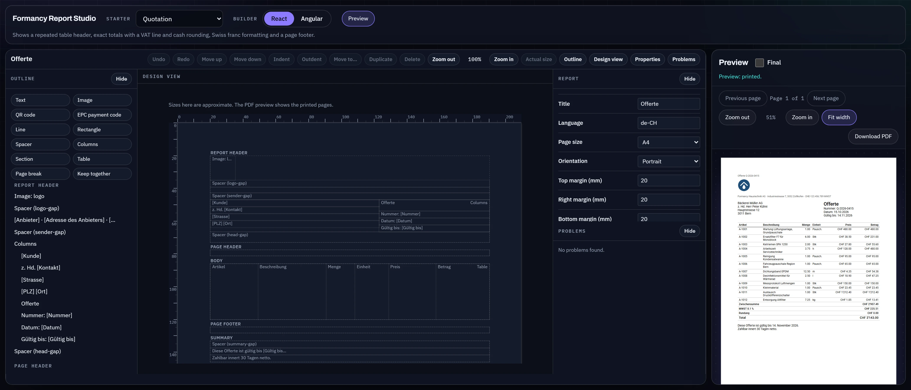
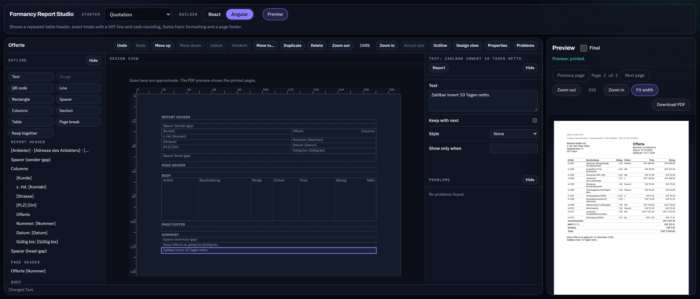
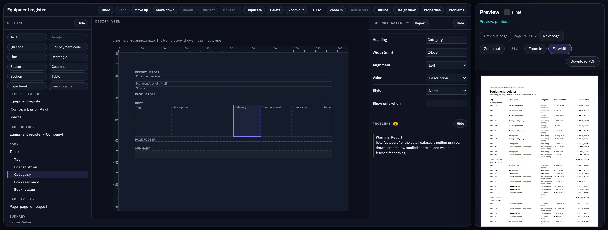
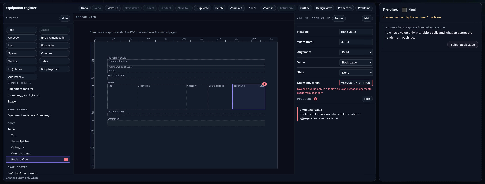
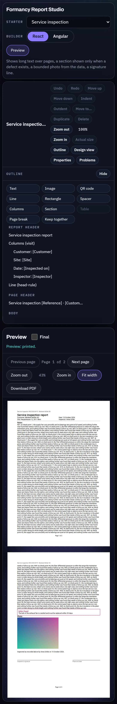
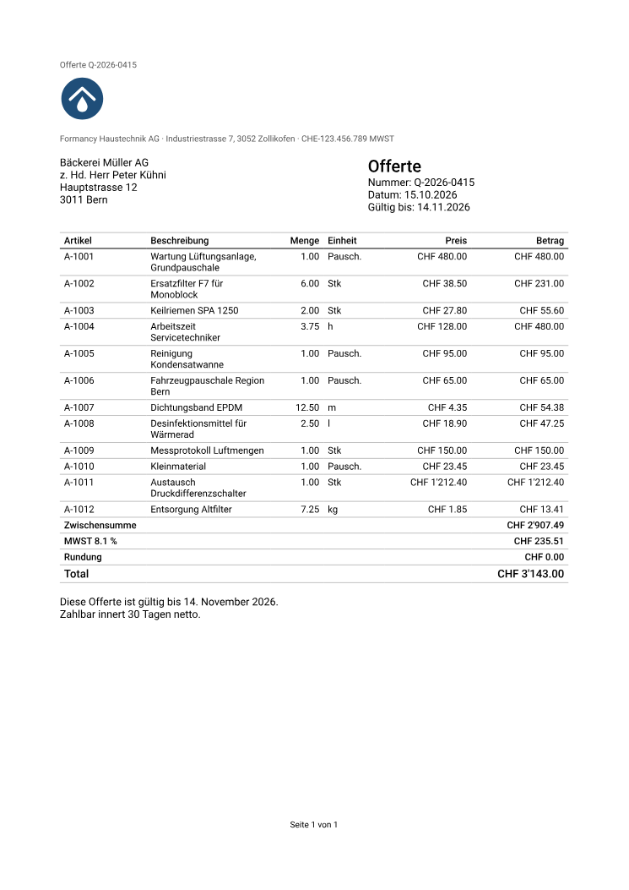
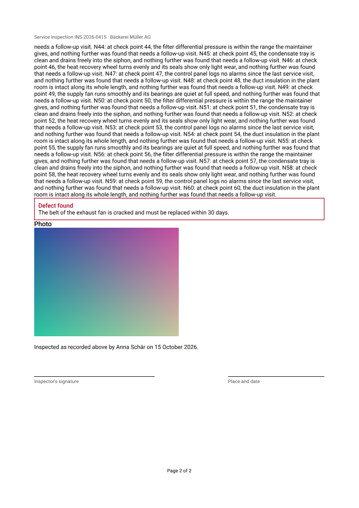
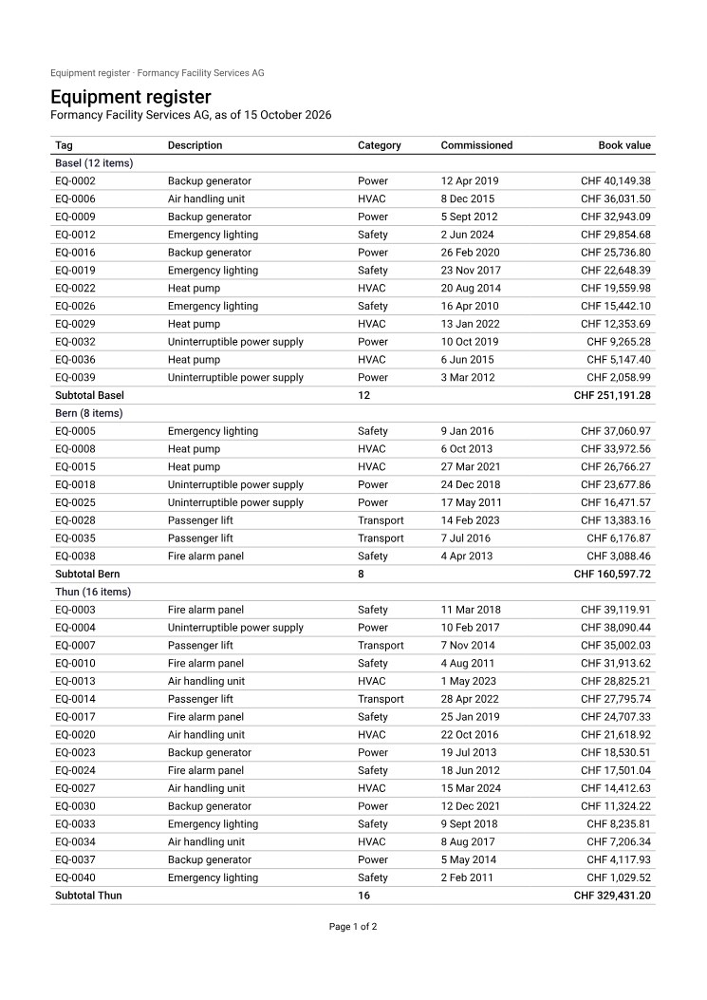

# Formancy Report

**Paginated PDF reports, designed inside your Angular or React application.**

A self-hosted reporting module for [formancy](https://github.com/sharkysan/formancy.ai).
An author lays out a report in a visual editor with native Angular and React
builders over one shared session. The report is saved in a versioned format of
its own, and a server renders it from an authorised snapshot of the data into a
PDF that the preview and the download both show. The data comes from your
application as JSON, from a formancy form's submissions, or, through
[Formancy Data](https://github.com/sharkysan/formancy.ai-data), from an
approved PostgreSQL or SQL Server dataset. An AI can propose changes, which
are reviewed against the same sample data before they apply. Report works
without any AI dependency.

**Start with [the getting-started guide](./docs/getting-started.md)**: a
quotation printed as a PDF in Node and in a browser, the editor in a React
page that saves and previews, and in an Angular page. The install gate
compiles its code against the packed packages and runs it, or bundles it
for a browser where it needs one, so its code fails CI when it stops being
true; of its prose, a guard holds the files it names, its install lines and
its links, and review the rest
([0015](./docs/decisions/0015-the-getting-started-guide-is-compiled-and-run-by-the-install-gate.md)).

> **Status, 16 October 2026: 0.1.0, a developer preview, is ready to
> release and not yet published.** Data goes in and a PDF comes out. A
> report can be laid out in a native React or Angular builder. The Studio
> puts both builders on one screen with the real PDF beside them:
> `pnpm --filter @formancy/report-studio dev`, once `pnpm build` has built
> the packages. What 0.1.0 holds and leaves out is in
> [the changelog](./CHANGELOG.md#010--2026-10-16).
>
> `@formancy/report-spec` defines the report format, validates a report and
> hashes it. `@formancy/report-core` edits a report through commands, with
> undo, and diagnoses its expressions as the runtime compiles them.
> `@formancy/report-runtime` checks the data a host hands it against the
> report's contracts, computes every total exactly and formats each value
> for the report's locale, or refuses
> ([0010](./docs/decisions/0010-the-runtime-resolves-a-report-into-a-renderer-neutral-document.md)).
> `@formancy/report-render-pdf` draws the result with pdfmake, in Node and
> through a browser entry, and refuses what it cannot draw whole
> ([0011](./docs/decisions/0011-report-render-pdf-draws-the-document-and-refuses-what-it-cannot.md)).
> The browser entry, `@formancy/report-render-pdf/browser`, prints every
> starter in the Studio, in Chromium.
> `@formancy/report-builder-core` is the editor model, and
> `@formancy/report-builder-react` and `@formancy/report-builder-angular`
> render it natively over one session, held to each other by shared
> scenarios and by their accessible trees, compared in the Studio in jsdom
> and in Chromium
> ([0012](./docs/decisions/0012-the-builders-are-native-and-share-one-session.md)).
> The Studio, `apps/studio`, is private: it switches between the two
> builders over one session and previews the PDF the session prints, in
> formancy.ai's room; its browser gate measures it in Chromium alone
> ([0013](./docs/decisions/0013-the-studio-is-the-same-room-and-its-pictures-are-taken-by-a-script.md)).
> `@formancy/report-corpus` is private test support: adversarial fixtures,
> the three starter reports, and the checks that prove a rendered PDF. The
> format is version 0, a draft: a report written now is not promised to be
> read by a later release.

## The Studio

`apps/studio` is the playground, private and never published. It opens the
three starters, and a blank report, in the React or the Angular builder,
over one report session per starter, and previews the PDF the renderer
prints from that session: in the page, on white paper, through
`@formancy/report-render-pdf/browser` and PDF.js. It works in the same room
as formancy.ai's admin and Formancy Data's Studio. `pnpm --filter
@formancy/report-studio dev` serves it on port 4394, once `pnpm build` has
built the packages it imports.

<!-- generated by scripts/pictures/readme.mjs from scripts/pictures/scenes.json: studio; do not edit -->



*The quotation starter in the React builder: the workbench's outline, design view and properties over one report session. Beside it the Preview, the session's document resolved against the starter's synthetic data by `@formancy/report-runtime`, printed in the page by `@formancy/report-render-pdf/browser` and drawn by PDF.js on white paper, down to “Total CHF 3'143.00” ([0010](./docs/decisions/0010-the-runtime-resolves-a-report-into-a-renderer-neutral-document.md), [0011](./docs/decisions/0011-report-render-pdf-draws-the-document-and-refuses-what-it-cannot.md)).*



*The quotation's payment line edited in React to “Zahlbar innert 10 Tagen netto.”, then the switch moved to Angular. The Angular builder draws the same editor over the same session, so the edit is there, still selected, and so is its Undo; the Preview prints the edited line. Switching frameworks keeps the document, its history, the selection and the zoom ([0012](./docs/decisions/0012-the-builders-are-native-and-share-one-session.md)).*



*The equipment register with its Category column set to show the description instead. The builder says what that leaves behind before anything is rendered: “field "category" of the detail dataset is neither printed, drawn, ordered by, totalled nor read, and would be fetched for nothing”. A warning renders as written, so the Preview still prints the register grouped by site, with “Basel (12 items)” heading its group ([0009](./docs/decisions/0009-an-expression-is-checked-and-bound-member-by-member.md)).*



*The Book value column given the condition `row.value > 1000`, which reads a row where a column's condition has none. The builder marks it as an error, and the runtime refuses to print the preview rather than guess: “Preview: refused by the runtime, 1 problem.”, with its reason, “row has a value only in a table's cells and what an aggregate reads from each row”. Its button, “Select Book value”, pressed with Enter, selected the column and put the keyboard on its outline row, with the condition in its properties ([0010](./docs/decisions/0010-the-runtime-resolves-a-report-into-a-renderer-neutral-document.md)).*

<details>
<summary>More: At a phone's width</summary>



*At 390 pixels wide, the service inspection starter as the Studio opens. The bar's controls take a line each, the builder shows one pane at a time, chosen from its toolbar, and the Preview follows under it with each page at the width there is, “Page 1 of 2” and the next; nothing scrolls sideways, which the Studio's browser gate measures down to 320 pixels.*

</details>

Every picture in this section is taken by `node scripts/pictures.mjs`, in Chromium, from the built Studio driven through its controls, never by hand. `pnpm --filter @formancy/report-studio test:pictures` walks the same states and fails when a picture's elements no longer say what they said when it was taken, or when a caption quotes what they do not say, and `pnpm test:repo` holds every caption to its picture's record. CI runs both, in its `browser` job. Neither looks at the pixels: a change of colour or layout alone is seen only by looking. And a caption is held to the text its elements hold, not to how much of that text a pane has scrolled or cut out of the picture.

<!-- end generated -->

## Licence, in one table

Source-available, **not** open source. The formancy engine, renderers, builder
and backend this module builds on stay Apache-2.0; this module does not. Its
terms are Formancy Data's.

| Use | Terms |
| --- | --- |
| Read the source and fork the repository | Free |
| Evaluate, develop and test — including in companies | Free |
| Run in production, internally or customer-facing | Paid licence |
| Redistribute inside another software product | Separate commercial agreement |
| Customer data, report templates and generated documents | Remain the customer's |

<!-- generated by scripts/licence-status.mjs from LICENSE.md; do not edit -->

[`LICENSE.md`](./LICENSE.md) has the terms. It is Version 1, in force from 14 October 2026, and says at the top that no lawyer has reviewed it. A production licence is requested from [info@formancy.ai](mailto:info@formancy.ai), as its section 9 says.

<!-- end generated -->

Why a paid module exists beside an Apache-2.0 project, in a repository of its
own, on Formancy Data's terms and before a lawyer has read them, is decision
[0001](./docs/decisions/0001-a-paid-module-in-its-own-repository.md).

## Packages

| Package | What it is |
| --- | --- |
| `@formancy/report-spec` | The report definition, version 0 (a draft): its types, structural validation with stable error codes, a canonical hash, page geometry and the one conversion between millimetres and points. A report is a document of its own, not a form ([0007](./docs/decisions/0007-a-report-definition-is-its-own-versioned-document.md)). No framework, no PDF engine, no Node. |
| `@formancy/report-core` | The editing core: pure commands over a report, also as data for a proposal; a session that commits only what the validator accepts, with exact undo and redo; the places a component may go; and one compilation of every expression, each member checked as its type, which the diagnostics report and the runtime evaluates. A refused edit changes nothing ([0008](./docs/decisions/0008-edits-are-commands-and-a-refused-edit-changes-nothing.md), [0009](./docs/decisions/0009-an-expression-is-checked-and-bound-member-by-member.md)). No framework, no PDF engine, no Node. |
| `@formancy/report-runtime` | Resolves a report against its data: every value held to its dataset's contract, exact numbers as strings and never through a JavaScript number, fields the report does not declare refused; totals computed exactly and rounded once as declared; values formatted for the report's locale; a renderer-neutral document, a manifest and, for a preview, its warnings. A final render refuses incomplete data ([0010](./docs/decisions/0010-the-runtime-resolves-a-report-into-a-renderer-neutral-document.md)). No framework, no PDF engine, no Node. |
| `@formancy/report-render-pdf` | Draws a resolved document with pdfmake and Roboto: page header and footer, tables whose header repeats and whose totals stay with their last row, columns, framed sections, images, rules. It refuses what it cannot draw whole -- a page too many, a word wider than its column, a character the font cannot draw -- rather than return a partial PDF ([0005](./docs/decisions/0005-pdfmake-renders-reports-behind-one-adapter.md), [0011](./docs/decisions/0011-report-render-pdf-draws-the-document-and-refuses-what-it-cannot.md)). Node, and a browser entry. |
| `@formancy/report-builder-core` | The editor model both builders render, with no framework: one person's view of a report-core session, and the outline, palette, property fields, design view, drop targets, diagnostics, keys and words derived from it, in English, Swiss German and Swiss French. Several editors share one session and its undo history. Its `report-builder.css` dresses both builders through formancy's workbench variables. `BUILDER_SCENARIOS` is what every builder must do, as data ([0012](./docs/decisions/0012-the-builders-are-native-and-share-one-session.md)). No framework, no DOM, no Node. |
| `@formancy/report-builder-react` | The builder for React 19: the workbench's panes over one editor, through `useSyncExternalStore`. Runs every shared scenario in three languages, with axe. |
| `@formancy/report-builder-angular` | The builder for Angular 22: standalone components, signals and `OnPush`, no zone.js, built by ng-packagr. Runs every shared scenario in three languages, with axe; no React in its closure. It is packed from `dist/`, and the install gate compiles it into an Angular host ahead of time, links it and draws it on a server. |
| `apps/studio` (`@formancy/report-studio`) | The playground, private and never published: the starters and a blank report in either builder over one session per starter, the PDF the session prints previewed by PDF.js on white paper, and every problem printing found linked to its component. The PDF.js viewer lives here and nowhere published ([0013](./docs/decisions/0013-the-studio-is-the-same-room-and-its-pictures-are-taken-by-a-script.md)). Its browser gate and its README pictures' check run in CI's `browser` job. |
| `@formancy/report-corpus` | Private test support, never published. Adversarial reports an engine must render or refuse -- a long table, a row taller than a page, a group ending at a page boundary, a summary at the foot of a page, exact decimals, text outside ASCII, images, an oversized job -- with a PDF.js reader and the checks that prove a rendered PDF against them ([0003](./docs/decisions/0003-a-rendered-report-is-proved-on-the-pdf-it-produced.md)); the three starter reports; and the renderer trial's adapters for pdfmake and pdfme. |

Planned and not here: the server and its jobs, reviewed AI changes, a
published PDF viewer, and the optional Formancy Data provider.

## Render a report

A host resolves a report against the data it is allowed to show, then
renders it. Nothing here fetches data or follows an address: the report
names its datasets and assets, and the host hands over both.

```ts
import { resolveReport } from '@formancy/report-runtime'
import { renderPdf, RenderRefusal } from '@formancy/report-render-pdf'

const resolution = resolveReport(report, data, { mode: 'final', parameters: {}, creationDate: '2026-10-15T08:00:00Z' })
if (!resolution.ok) throw new Error(resolution.errors.map((error) => `${error.code} at ${error.path}`).join('; '))
const pdf: Uint8Array = await renderPdf(resolution.document, { maxPages: 50 })
```

`resolveReport` refuses, with every reason at once, a report the editor's
diagnostics refuse, data that breaks its contract, and, in a final render,
data the provider calls incomplete; it never returns part of a document.
`renderPdf` rejects with a `RenderRefusal` whose `code` says what stopped it
-- `too-many-pages`, `content-too-large`, `invalid-asset`, `cancelled` or
`unsupported` -- and never resolves to a partial PDF. The install gate runs
these lines, from the packed packages, on the quotation starter below
(`scripts/install-fixture/consume.ts`).

## What the starters print

The three starter reports, resolved by the runtime from their synthetic
data, rendered by `report-render-pdf` and drawn by PDF.js. The pictures are
made by `packages/report-render-pdf/scripts/readme-pictures.ts`, never by
hand, and `pictures.test.ts` fails when a page no longer prints what its
picture shows, or a caption quotes what the page does not print.







The Studio shows the same pages beside the editor, printed in the page
from the session; its pictures are [above](#the-studio).

## How it relates to formancy.ai and Formancy Data

Report **depends on** the released `@formancy/*` packages and copies none of
their code ([0002](./docs/decisions/0002-depend-on-upstream-never-copy-it.md)).
Upstream versions are exact, and a guard refuses a range or a path. Where
Report needs a form, it uses one: parameter forms render through the formancy
renderers, and expressions and exact decimals come from formancy's packages.
A report is its own document, though, with pages, flowing tables, groups and
totals that a form does not model. Report never widens the form spec to hold
them.

Formancy Data is optional. Report reads Data's approved datasets through one
provider package, and only once Data publishes a release. Without Data, a host
application supplies the data itself. Data never depends on Report.

## Development

Node 22.13 or later, which `pdfjs-dist` 6.4 needs, and pnpm through corepack.

```bash
corepack enable pnpm
pnpm install
pnpm build
pnpm test
```

The gates CI runs, from `.github/workflows/gates.yml`: `pnpm build`,
`pnpm typecheck`, `pnpm check:pkg`, `node scripts/verify-licenses.mjs`,
`node scripts/dependency-licences.mjs` and `pnpm test:repo`; each package's
`test:coverage`, the Studio's included, in a job of its own; the Studio's
browser gate and its README pictures' check, in Chromium (`pnpm test:browser`
and `pnpm test:pictures`, after `pnpm build` and `pnpm --filter
@formancy/report-studio exec playwright install chromium`); and
`pnpm test:e2e:install`, which packs the packages and installs them into
plain npm projects, one per kind of host, each holding only what that host
has. Type-checking is strict, with `skipLibCheck` off. A Node program drives
the packages without a framework end to end. The React builder is checked as
a browser's code and drawn by React's server renderer, in its development and
its production build. The Angular builder is compiled into a host ahead of
time with strict templates, linked as the Angular CLI links it, and drawn by
Angular's platform-server without the JIT compiler. Each builder is also
bundled for a browser, and checked at the newest and the oldest release its
peer range admits. Neither is mounted in a DOM there. The same gate builds
[the getting-started guide](./docs/getting-started.md)'s code: its Node
program is run and must print what the guide shows, its React page has a
project of its own that also installs the renderer, and its Angular page is
compiled into the Angular builder's projects; each page is drawn on a server
and bundled for a browser, at both ends of its builder's peer range
([0015](./docs/decisions/0015-the-getting-started-guide-is-compiled-and-run-by-the-install-gate.md)).
[`CLAUDE.md`](./CLAUDE.md) says what each is for and what the bar is.

Every run of the gates ends in a release report of what that run was tested
on and what it found, which fails the run on anything it cannot show; a
release publishes only what its own run's report passed, and attaches the
report, signed
([0014](./docs/decisions/0014-a-release-report-is-derived-from-the-run-that-gated-it.md),
[`docs/release/`](./docs/release/README.md)).

### What it is tested with

<!-- generated by scripts/release-report/readme.mjs; do not edit -->

| | Tested with | Declared as |
| --- | --- | --- |
| `@formancy/expressions` | 0.5.0 | `0.5.0` |
| `@formancy/spec` | 0.5.0 | `0.5.0` |
| `@formancy/themes` | 0.5.0 | `0.5.0` |
| `tslib`, by `@formancy/report-builder-angular` | 2.8.1 | `^2.8.0` |
| `pdfmake`, by `@formancy/report-render-pdf` | 0.3.11 | `0.3.11` |
| `@angular/core`, a peer of `@formancy/report-builder-angular` | 22.2.2, in its suites | `^22.0.0` |
| `react`, a peer of `@formancy/report-builder-react` | 19.3.1, in its suites | `^19.0.0` |
| `react-dom`, a peer of `@formancy/report-builder-react` | 19.3.1, in its suites | `^19.0.0` |
| Node, the workspace |  | `>=22.13.0` |
| Node, CI | 22 |  |
| pnpm | 12.4.2, through corepack | `pnpm@12.4.2`, the root's `packageManager` |
| Chromium | 156.0.8078.4, the chromium-headless-shell Playwright 1.64.1 pins (revision 1248) |  |
| `typescript` | 6.0.3 | `~6.0.3` |
| `vitest` | 5.0.4 | `^5.0.1` |
| `pdfjs-dist` | 6.4.299 | `6.4.299` |
| `jsdom` | 30.1.2 |  |
| `axe-core` | 4.14.0 |  |
| `playwright` | 1.64.1 | `^1.63.0` |

What a run actually ran -- the Node of each job, the React and Angular each install host resolved at both ends of the builders’ peer ranges, and the Chromium the browser gate launched -- is in the release report every CI run produces and every release attaches, signed.

<!-- end generated -->

## Documents

- [`docs/getting-started.md`](./docs/getting-started.md) — from an empty npm project to a PDF and the editor in your page. The install gate compiles every block of its code against the packed packages and runs it, or bundles it for a browser, and `scripts/getting-started.test.mjs` fails when a block escapes the gate or imports a package the guide never says to install.
- [`docs/decisions/`](./docs/decisions/README.md) — every decision somebody could helpfully undo, with what verifies it.
- [`CHANGELOG.md`](./CHANGELOG.md) — what changed and why.
- [`CONTRIBUTING.md`](./CONTRIBUTING.md) and [`CLA.md`](./CLA.md) — contributions are taken under a CLA, checked on every pull request.
- [`SECURITY.md`](./SECURITY.md) — how to report a vulnerability, and what this product considers highest risk.
- [`RELEASING.md`](./RELEASING.md) — releases are cut by the workflow, with provenance, a signed SBOM and the signed release report of the run that gated them.
- [`docs/release/`](./docs/release/README.md) — what the release report holds, what fails it, and its two registers: the release gates and the known limitations.
