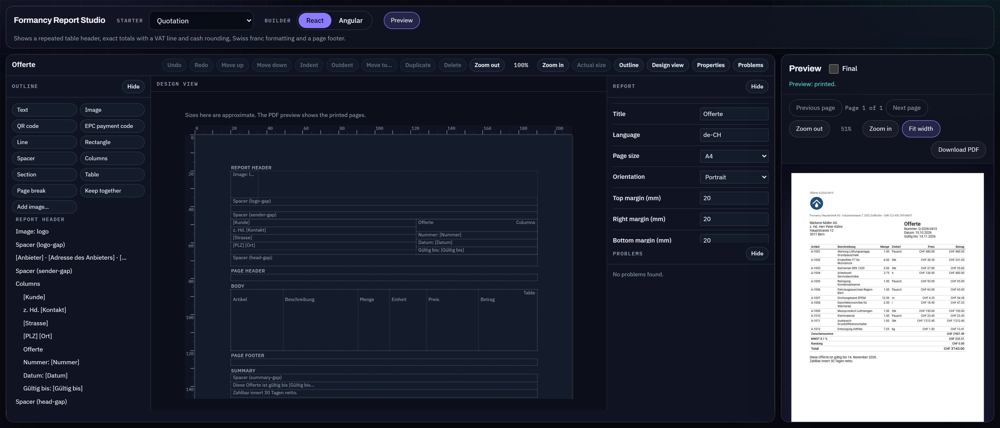
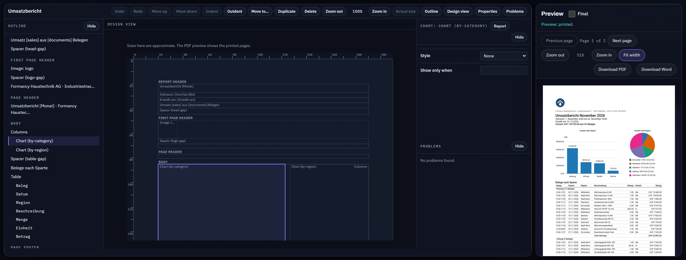
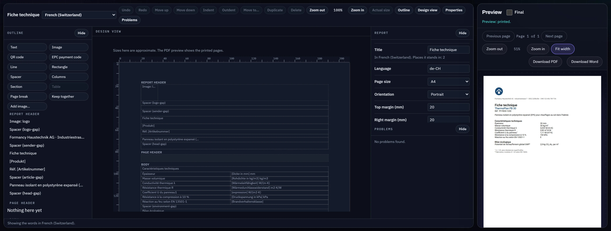
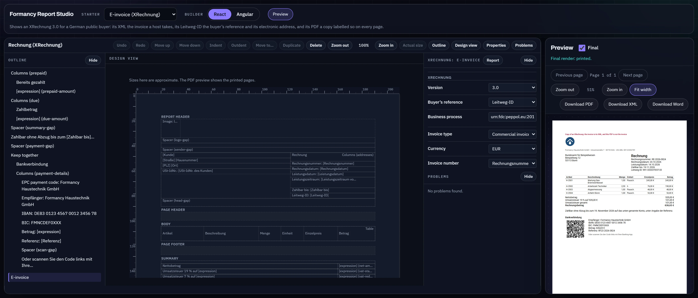
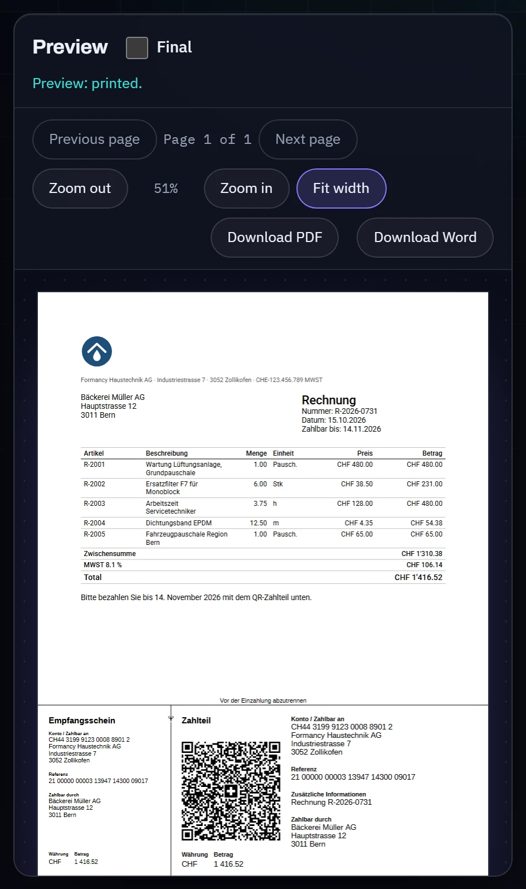
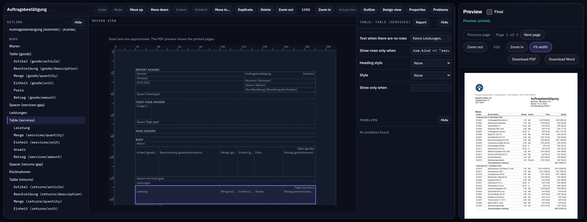
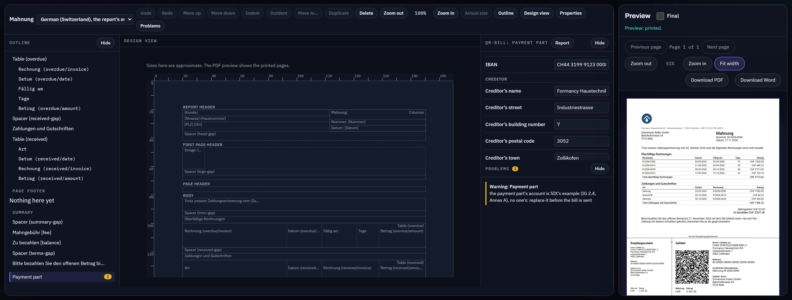
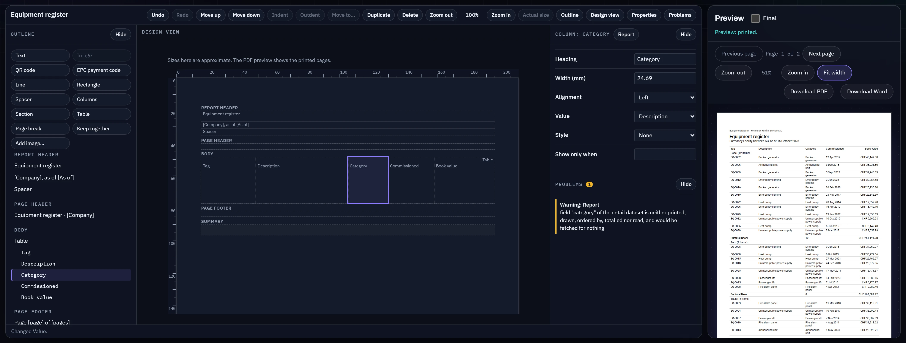
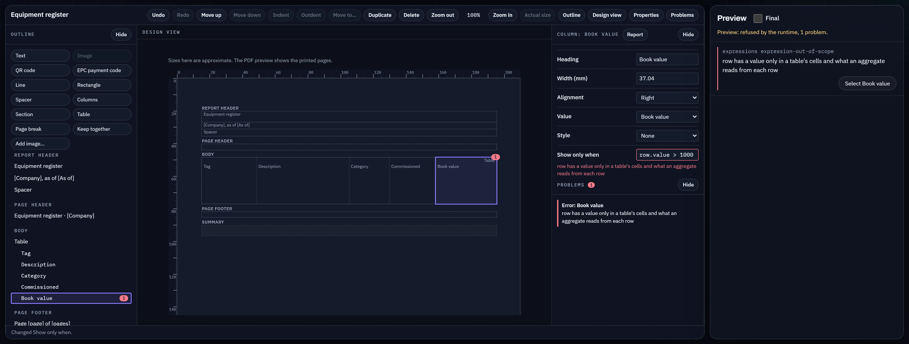
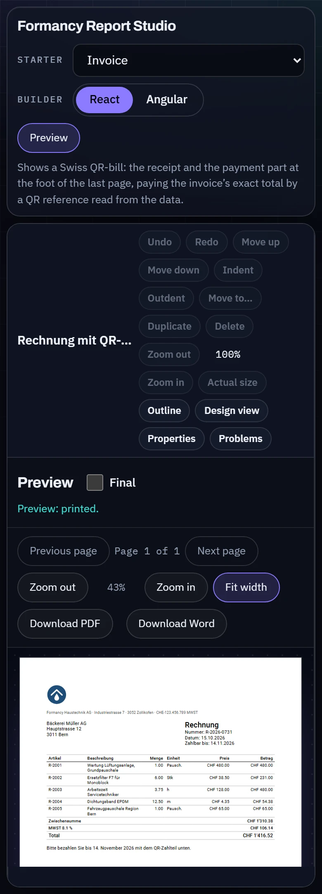

# Formancy Report

**Paginated PDF reports, and Word files of them, designed inside your Angular or React application.**

Formancy Report is a paid, [source-available](#licence-in-one-table) module
for the documents a business sends: quotations, invoices paid by a Swiss
QR-bill or an EPC QR code, e-invoices, order confirmations, data sheets,
payment reminders, sales reports with charts. A person designs them inside
your application, and your application prints them from its own data. It
builds on the Apache-2.0 [formancy](https://github.com/sharkysan/formancy.ai)
packages; you host it, and you hand it the data.

**[Open the Studio](https://formancy.ai/report/)** ·
**[Download the samples](./samples/README.md)** ·
**[Get started](./docs/getting-started.md)**

<!-- generated by scripts/pictures/readme.mjs from scripts/pictures/scenes.json: hero; do not edit -->



*The quotation starter in the React builder, and beside it the Preview: the PDF the runtime and the renderer print from the same session, down to “Total CHF 3'143.00” ([0010](./docs/decisions/0010-the-runtime-resolves-a-report-into-a-renderer-neutral-document.md), [0011](./docs/decisions/0011-report-render-pdf-draws-the-document-and-refuses-what-it-cannot.md)).*

Taken by a script from the built Studio and held to the text it shows, as every picture under [The Studio](#the-studio) is.

<!-- end generated -->

## What it does

- **Design inside your application**, in a native React or Angular builder over one session, with undo, told what is wrong before anything renders ([0012](./docs/decisions/0012-the-builders-are-native-and-share-one-session.md), [0009](./docs/decisions/0009-an-expression-is-checked-and-bound-member-by-member.md)).
- **Print exact PDFs**, in Node or in a browser: totals exact and rounded once, values formatted for the report's language, and a report that cannot be drawn whole refused, never cut ([0010](./docs/decisions/0010-the-runtime-resolves-a-report-into-a-renderer-neutral-document.md), [0011](./docs/decisions/0011-report-render-pdf-draws-the-document-and-refuses-what-it-cannot.md)).
- **Write Word files** of the same document, which a person can go on editing: Word lays out their lines and pages, and what belongs to the PDF alone is refused, never left out ([0068](./docs/decisions/0068-a-report-is-written-as-a-word-file-by-a-writer-of-its-own-and-what-belongs-to-its-pdf-is-refused.md)).
- **Get paid by code**: a Swiss QR-bill and an EPC QR code for a SEPA transfer, held to SIX's and the EPC's rules and edited field by field in either builder ([0022](./docs/decisions/0022-a-report-carries-one-swiss-qr-bill-at-the-foot-of-its-last-page.md), [0025](./docs/decisions/0025-a-report-prints-an-epc-qr-code-held-to-the-epc-rules-beside-the-qr-bill.md), [0039](./docs/decisions/0039-a-person-selects-a-reports-qr-bill-and-edits-it-field-by-field-in-either-builder.md)).
- **Issue e-invoices**: a Factur-X / ZUGFeRD PDF/A-3b that embeds its EN 16931 XML, or an XRechnung 3.0 whose XML your application takes and sends; Report sends nothing. Mustang and KoSIT's validator judge the repository's e-invoice XML, and veraPDF and Mustang its Factur-X PDFs. France is not claimed ([0027](./docs/decisions/0027-a-report-carries-one-en-16931-invoice-written-from-the-values-its-page-prints.md), [0031](./docs/decisions/0031-an-e-invoice-is-drawn-as-a-pdf-a-3b-that-embeds-its-xml.md), [0038](./docs/decisions/0038-a-reports-e-invoice-may-be-an-xrechnung-3-0-whose-xml-a-host-takes-and-whose-pdf-is-its-labelled-copy.md)).
- **Archive as PDF/A-2b** any report that is no e-invoice, where your application asks; what a PDF/A cannot hold -- a CMYK JPEG, an SVG past its bounds, a title holding `&`, `<` or `>` -- is refused at that render ([0057](./docs/decisions/0057-a-report-that-is-no-e-invoice-is-drawn-as-a-pdf-a-2b-where-the-host-asks-for-one.md)).
- **Chart it**: bar, line and pie charts of the detail rows, totalled as the tables are and laid out by Apache ECharts, not yet in the builders' palettes ([0052](./docs/decisions/0052-a-report-draws-a-bar-line-or-pie-chart-of-its-detail-rows-each-series-a-total-of-one-field-per-category.md), [0058](./docs/decisions/0058-the-renderer-lays-a-chart-out-with-apache-echarts-and-prints-its-marks-and-its-words-where-echarts-placed-them.md)).
- **One template, several languages**: a render prints in the one it names, and a word missing there refuses it ([0063](./docs/decisions/0063-a-reports-own-words-are-written-in-each-language-it-declares-and-a-render-names-the-one-it-prints-in.md)).
- **Lay it out**: several tables over one list of lines, group headers kept with their rows, a first page of its own, text set above or below the line, fonts your application approves, pinned by digest, and SVG logos made of shapes alone -- no text, no embedded picture ([0062](./docs/decisions/0062-a-report-holds-several-tables-over-its-detail-rows-each-printing-and-totalling-the-rows-its-condition-selects.md), [0060](./docs/decisions/0060-a-reports-first-page-may-print-a-header-of-its-own-or-none-in-place-of-the-page-header.md), [0061](./docs/decisions/0061-a-paragraphs-run-may-be-set-below-or-above-the-line-in-any-character-its-face-draws-and-prints-only-beside-a-run-on-the-line.md), [0043](./docs/decisions/0043-a-report-maps-its-font-tokens-to-fonts-the-host-approved-pinned-by-digest-and-the-renderer-embeds-them.md), [0030](./docs/decisions/0030-an-image-asset-may-be-an-svg-of-drawing-elements-alone-cleaned-once-and-refused-at-print-in-any-other-form.md)).
- **Read your data where it lives**: your application's JSON, a formancy form's submissions, each against the form version that collected it, or a Formancy Data 0.5.0 server, best-effort ([0042](./docs/decisions/0042-a-report-reads-a-formancy-forms-submissions-against-the-exact-version-that-collected-them-as-the-host-hands-them-over.md), [0016](./docs/decisions/0016-the-data-provider-reads-formancy-data-0-1-0-best-effort.md)).
- **Let a coding agent work against Report's checks**: an MCP server, run by the agent's client, that describes the format and the commands, judges a report as the validator and a render would, within the size a draft may have, and applies commands as the builders do; it needs no server, and saves, publishes and fetches nothing ([0088](./docs/decisions/0088-an-agent-gets-reports-checks-over-the-model-context-protocol-from-a-server-of-reports-own.md)).
- **Keep drafts on a server**: it verifies your application's token offline and keeps each tenant's template drafts and images; it renders nothing yet ([0046](./docs/decisions/0046-report-has-a-server-of-its-own-over-the-hosts-verified-identity.md), [0049](./docs/decisions/0049-a-templates-draft-is-kept-by-the-report-server-one-per-tenant-saved-by-compare-and-swap.md)).

What is planned next, and what is not planned at all, is in
[the roadmap](./docs/roadmap.md).

## What it prints

Every starter, printed from its synthetic data as a final render: download
its PDF and its Word file, and an e-invoice's XML.
[`samples/`](./samples/README.md) says how they are made, and
`pnpm test:repo` holds them, and this table, to what the current build
writes
([0079](./docs/decisions/0079-every-starters-pdf-and-word-file-are-committed-as-samples-held-to-the-build-and-the-readme-draws-every-package-in-a-sketch.md)).

<!-- generated by scripts/samples.mjs: starters; do not edit -->

| Starter | Pages | Language | Its PDF holds | Download |
| --- | --- | --- | --- | --- |
| Service inspection | 2 | en-GB | a picture | [PDF](./samples/service-inspection.pdf) · [Word](./samples/service-inspection.docx) |
| Quotation | 1 | de-CH | a table, a picture | [PDF](./samples/quotation.pdf) · [Word](./samples/quotation.docx) |
| Grouped equipment | 2 | en-GB | a table | [PDF](./samples/grouped-equipment.pdf) · [Word](./samples/grouped-equipment.docx) |
| Invoice | 1 | de-CH | a table, a picture, a Swiss QR-bill | [PDF](./samples/invoice.pdf) · [Word](./samples/invoice.docx) |
| Euro invoice | 1 | de-DE | a table, a picture, an EPC QR code | [PDF](./samples/euro-invoice.pdf) · [Word](./samples/euro-invoice.docx) |
| E-invoice (Factur-X) | 1 | de-DE | a Factur-X e-invoice, a table, a picture, an EPC QR code | [PDF](./samples/e-invoice.pdf) · [Word copy](./samples/e-invoice.docx) · [XML](./samples/e-invoice.xml) |
| E-invoice (XRechnung) | 1 | de-DE | an XRechnung's copy, a table, a picture, an EPC QR code | [PDF copy](./samples/e-invoice-xrechnung.pdf) · [Word copy](./samples/e-invoice-xrechnung.docx) · [XML, the invoice](./samples/e-invoice-xrechnung.xml) |
| Site visit | 1 | de-CH | a table | [PDF](./samples/site-visit.pdf) · [Word](./samples/site-visit.docx) |
| Order confirmation | 2 | de-CH | 3 tables, a picture, a first page of its own | [PDF](./samples/order-confirmation.pdf) · [Word](./samples/order-confirmation.docx) |
| Product data sheet | 1 | de-CH | a picture, text set above or below the line | [PDF](./samples/product-data-sheet.pdf) · [Word](./samples/product-data-sheet.docx) |
| Payment reminder | 1 | de-CH | 2 tables, a picture, a Swiss QR-bill, a first page of its own | [PDF](./samples/payment-reminder.pdf) · [Word](./samples/payment-reminder.docx) |
| Sales report | 2 | de-CH | a table, 2 charts, a picture, a first page of its own | [PDF](./samples/sales-report.pdf) · [Word](./samples/sales-report.docx) |

<!-- end generated -->


Every starter's page, the invoice in four languages and the euro invoice
from six countries are in [What the starters print](./docs/starters.md).

> **Status, 27 November 2026:** 0.3.0, a developer preview, is published
> on npm, and [its release](https://github.com/sharkysan/formancy.ai-report/releases/tag/v0.3.0)
> carries the report of the run that gated it.
> What 0.3.0 holds and leaves out is
> [its section of the changelog](./CHANGELOG.md#030--2026-11-23), and
> what `main` gains after it is under *Unreleased* there, among it
> `@formancy/report-mcp`, which no release has published yet, and
> `@formancy/report-ai`, a model's turn in formancy's shapes, which asks a
> model for nothing yet
> ([0083](./docs/decisions/0083-the-models-turn-is-held-in-report-ai-in-formancys-shapes-until-formancy-releases-one-other-products-may-brief.md)). The
> report format is still version "0", the draft: a report written now is
> not promised to be read by a later release
> ([0004](./docs/decisions/0004-three-version-lines-each-refused-when-unknown.md)).

## Try it

The Studio is online at https://formancy.ai/report/, and runs from a clone
with Node 22.13 or later and corepack:

```bash
git clone https://github.com/sharkysan/formancy.ai-report.git
cd formancy.ai-report
corepack enable pnpm
pnpm install
pnpm demo
```

`pnpm demo` builds the packages and the Studio, then serves it at
http://localhost:4394. It opens on the invoice, whose Swiss QR-bill is at
the foot of its page
([0082](./docs/decisions/0082-the-studio-opens-on-the-invoice-and-lists-it-first-and-the-corpus-keeps-its-order.md)).
Pick another starter or a blank report, edit it in either
builder, and download what the Preview prints. The starters' data is
synthetic and built in, and the page asks no other site for anything, which
the browser gate holds
([0023](./docs/decisions/0023-the-studio-and-the-pages-serve-their-own-faces-and-ask-no-other-site-for-anything.md)).
The online Studio is `main`'s, deployed on every push to `main`, so it can
be ahead of the latest release
([RELEASING.md](./RELEASING.md#the-demo-on-formancyai)); the product's
pages stand beside it, from https://formancy.ai/report/en/, in German,
French, Italian and English, with a page for each topic the start page
introduces
([0081](./docs/decisions/0081-the-start-page-names-pdf-and-word-pages-for-invoices-word-files-and-each-report-designer-join-it-and-every-package-names-keywords.md)).

## The Studio

`apps/studio` is the playground: both builders over one session and the
PDF they print, beside them or in the design view's place where the window
has no room
([0013](./docs/decisions/0013-the-studio-is-the-same-room-and-its-pictures-are-taken-by-a-script.md),
[0029](./docs/decisions/0029-the-preview-stands-in-the-design-views-place-where-it-does-not-fit-beside-the-builder.md)).

<!-- generated by scripts/pictures/readme.mjs from scripts/pictures/scenes.json: studio; do not edit -->



*The sales report, its bar chart selected as “Chart (by-category)”. Each bar's label is its product line's total in the table, “63'482.00” over “Total Heizung CHF 63'482.00”, and each legend entry a region's total and share, as “Stadt Bern: 38'209.70 (30.6%)”. The builders do not edit a chart's own properties yet ([0067](./docs/decisions/0067-a-monthly-sales-report-is-a-starter-whose-bar-chart-and-pie-print-the-totals-its-table-prints.md), [0058](./docs/decisions/0058-the-renderer-lays-a-chart-out-with-apache-echarts-and-prints-its-marks-and-its-words-where-echarts-placed-them.md)).*



*The product data sheet switched to French in the builder's bar, “Showing the words in French (Switzerland).”, and the Preview printing it in French, from “Fiche technique” to “Caractéristiques techniques”. A word missing in a language refuses that language's render ([0063](./docs/decisions/0063-a-reports-own-words-are-written-in-each-language-it-declares-and-a-render-names-the-one-it-prints-in.md), [0061](./docs/decisions/0061-a-paragraphs-run-may-be-set-below-or-above-the-line-in-any-character-its-face-draws-and-prints-only-beside-a-run-on-the-line.md)).*



*The XRechnung starter, “E-invoice (XRechnung)”, its e-invoice selected, “XRechnung: E-invoice”, and Final on. Its PDF says at the top of every page “Copy of an XRechnung: the invoice is its XML, and this PDF is not the invoice”; “Download XML” gives the invoice, and “Download Word” the copy ([0038](./docs/decisions/0038-a-reports-e-invoice-may-be-an-xrechnung-3-0-whose-xml-a-host-takes-and-whose-pdf-is-its-labelled-copy.md), [0065](./docs/decisions/0065-the-xrechnung-is-a-starter-beside-the-e-invoice-and-a-final-render-of-either-offers-its-xml-beside-its-pdf.md), [0077](./docs/decisions/0077-a-report-that-carries-an-e-invoice-is-written-into-a-word-file-as-the-copy-the-runtime-labels-on-every-page.md)).*



*The invoice's Preview: “Download PDF” gives the PDF, and “Download Word” a Word file of the same document, the QR-bill's slip a page of its own. Word lays out its lines and pages; this file was opened in Word once, by hand, on 20 November 2026, and no test opens one ([0068](./docs/decisions/0068-a-report-is-written-as-a-word-file-by-a-writer-of-its-own-and-what-belongs-to-its-pdf-is-refused.md), [0075](./docs/decisions/0075-a-qr-bills-slip-is-written-into-a-word-file-on-a-page-of-its-own-and-every-line-of-it-is-shown-to-fit.md)). Every starter's files are in [samples](./samples/README.md).*

<details>
<summary>More: The order confirmation's tables, The payment reminder's QR-bill, The same session in the Angular builder, A diagnostic, A refusal linked to its component, At a phone's width</summary>



*The order confirmation's services table, “Table (services)”, selected with its condition `row.kind == "service"`: one list of lines printed as three tables, each with its own total, the goods grouped by delivery, as “Zwischensumme Lieferung CHF 15'965.75” ([0062](./docs/decisions/0062-a-report-holds-several-tables-over-its-detail-rows-each-printing-and-totalling-the-rows-its-condition-selects.md), [0064](./docs/decisions/0064-an-order-confirmation-and-a-product-data-sheet-are-starters-that-print-what-0059-to-0063-added.md)).*



*The payment reminder's QR-bill, “QR-bill: Payment part”, selected and edited field by field; the builder warns that “the payment part's account is SIX's example (IG 2.4, Annex A), no one's: replace it before the bill is sent”, and the Preview prints “Zu bezahlen CHF 3'207.30” above the slip ([0066](./docs/decisions/0066-a-payment-reminder-is-a-starter-that-pays-the-balance-of-a-customers-overdue-invoices-by-a-qr-bill-in-the-customers-language.md), [0039](./docs/decisions/0039-a-person-selects-a-reports-qr-bill-and-edits-it-field-by-field-in-either-builder.md)).*


*The quotation's payment line edited in React to “Zahlbar innert 10 Tagen netto.”, then the switch moved to Angular: the same session, so the edit is there, still selected, with its Undo ([0012](./docs/decisions/0012-the-builders-are-native-and-share-one-session.md)).*



*The equipment register's Category column set to show the description: the builder warns before anything renders, “field "category" of the detail dataset is neither printed, drawn, ordered by, totalled nor read, and would be fetched for nothing”, and the Preview still prints, “Basel (12 items)” heading its group ([0009](./docs/decisions/0009-an-expression-is-checked-and-bound-member-by-member.md)).*



*The Book value column given the condition `row.value > 1000`: the runtime refuses to print rather than guess, “Preview: refused by the runtime, 1 problem.”, saying why, “row has a value only in a table's cells and what an aggregate reads from each row”, and “Select Book value” takes the keyboard to the column ([0010](./docs/decisions/0010-the-runtime-resolves-a-report-into-a-renderer-neutral-document.md)).*



*At 390 pixels wide, the Studio as it opens, on the invoice: one pane at a time, the Preview in the design view's place, “Page 1 of 1”. Nothing scrolls sideways down to 320 pixels, which the browser gate measures ([0029](./docs/decisions/0029-the-preview-stands-in-the-design-views-place-where-it-does-not-fit-beside-the-builder.md), [0082](./docs/decisions/0082-the-studio-opens-on-the-invoice-and-lists-it-first-and-the-corpus-keeps-its-order.md)).*

</details>

Every picture in this section is taken by `node scripts/pictures.mjs`, in Chromium, from the built Studio driven through its controls, never by hand. `pnpm --filter @formancy/report-studio test:pictures` walks the same states and fails when a picture's elements no longer say what they said when it was taken, or when a caption quotes what they do not say, and `pnpm test:repo` holds every caption to its picture's record. CI runs both, in its `browser` job. Neither looks at the pixels: a change of colour or layout alone is seen only by looking. And a caption is held to the text its elements hold, not to how much of that text a pane has scrolled or cut out of the picture.

<!-- end generated -->

## How it fits together

![A hand-drawn sketch of Formancy Report's packages on a dark background, in four columns, Edit, Print, Data in and Serve: the Studio and the product pages at the top; the MCP server for a coding agent below them; the builders, the two renderers, the test support, the form bridge, the data provider, the server and its client below that; then report-builder-core, report-runtime and report-server-core; report-ai, the model's turn; report-core; and report-spec and report-documents at the bottom. The editing column is violet, the printing column teal, and what is never published is dashed](docs/images/architecture.svg)

A report is a document of its own, versioned and validated by
`report-spec`. `report-core` changes it by commands with undo, and both
builders edit that one session. `report-runtime` resolves it against your
data, deciding every value once, and two engines print the result:
`report-render-pdf` as a PDF and `report-render-docx` as a Word file. Each
package depends only on those drawn below it, which
`scripts/architecture.test.mjs` holds to the manifests. `report-mcp`
gives a coding agent the same checks and commands over the Model Context
Protocol. [The architecture](./docs/README.md) says the rest.

## Render a report

Your application resolves a report against the data it may show, then
renders it. Nothing here fetches data or follows an address: the report
names its datasets and assets, and your application hands over both. Here
`report` is the quotation starter, `data` its synthetic data and `logo` its
mark's bytes and digest:

```ts
import { resolveReport } from '@formancy/report-runtime'
import type { ImageResolver } from '@formancy/report-runtime'
import { renderPdf, RenderRefusal } from '@formancy/report-render-pdf'

const images: ImageResolver = (ref) => (ref.asset === 'logo' && ref.digest === logo.digest ? { mediaType: 'image/svg+xml', bytes: logo.bytes } : undefined)
const resolution = resolveReport(report, data, { mode: 'final', parameters: {}, images, creationDate: '2026-10-15T08:00:00Z' })
if (!resolution.ok) throw new Error(resolution.errors.map((error) => `${error.code} at ${error.path}`).join('; '))
const pdf: Uint8Array = await renderPdf(resolution.document, { maxPages: 50 })
```

`resolveReport` refuses with every reason at once, and `renderPdf` rejects
with a `RenderRefusal` whose `code` says what stopped it; neither returns
part of a document. `renderDocx(resolution.document)`, from
`@formancy/report-render-docx`, writes the same document as a Word file.
The install gate runs these lines from the packed packages
(`scripts/install-fixture/consume.ts`).

## Packages

| Package | What it is |
| --- | --- |
| [`@formancy/report-spec`](./packages/report-spec/README.md) | The report format, version 0 (a draft): its types, validation, a canonical hash, and the rules of payment codes, e-invoices, SVGs and fonts |
| [`@formancy/report-documents`](./packages/report-documents/README.md) | The one PDF reader: a PDF read whole or refused, within measured bounds; nothing calls it yet |
| [`@formancy/report-core`](./packages/report-core/README.md) | Commands over a report, a session with exact undo, and one compilation of every expression |
| [`@formancy/report-ai`](./packages/report-ai/README.md) | A model's turn, in formancy's shapes: ask, read the answer, ask again with the latest complaint, stop, decline, or a person carries it by hand; it asks a model for nothing yet |
| [`@formancy/report-runtime`](./packages/report-runtime/README.md) | Resolves a report against its data into a renderer-neutral document, every value decided once, and writes an e-invoice's XML |
| [`@formancy/report-render-pdf`](./packages/report-render-pdf/README.md) | Draws that document with pdfmake, in Node and in a browser, or refuses it whole |
| [`@formancy/report-render-docx`](./packages/report-render-docx/README.md) | Writes that document as a Word file, the same bytes for the same document, and refuses what belongs to its PDF |
| [`@formancy/report-data-provider`](./packages/report-data-provider/README.md) | Reads a report's data from a Formancy Data 0.5.0 server, best-effort |
| [`@formancy/report-forms`](./packages/report-forms/README.md) | Reads a formancy form's submissions against the version that collected each, starts a report from a version, and reviews a new one |
| [`@formancy/report-server-core`](./packages/report-server-core/README.md) | Who may do what to a tenant's reports, the wire, and the use cases for drafts and images; no framework, no Node |
| [`@formancy/report-server`](./packages/report-server/README.md) | The server, on Fastify: your application's token verified offline, a template's draft and its images |
| [`@formancy/report-client`](./packages/report-client/README.md) | What your page asks that server with |
| [`@formancy/report-mcp`](./packages/report-mcp/README.md) | Report's checks for a coding agent, over the Model Context Protocol: the format described, a report validated and diagnosed, and report-core's commands applied, with nothing deployed |
| [`@formancy/report-builder-core`](./packages/report-builder-core/README.md) | The editor model both builders render; `BUILDER_SCENARIOS` is what each must do |
| [`@formancy/report-builder-react`](./packages/report-builder-react/README.md) | The builder for React 19 |
| [`@formancy/report-builder-angular`](./packages/report-builder-angular/README.md) | The builder for Angular 22: standalone components, signals and `OnPush`, no zone.js |

Beside them, `apps/studio` is [the Studio](#the-studio), `apps/pages` the
product's pages, and `@formancy/report-corpus` the private test support
that proves each PDF and Word file
([0003](./docs/decisions/0003-a-rendered-report-is-proved-on-the-pdf-it-produced.md));
none is published.

## Licence, in one table

Source-available, **not** open source. The formancy packages this module
builds on stay Apache-2.0; this module does not. It is on Formancy Data's
terms.

| Use | Terms |
| --- | --- |
| Read the source and fork the repository | Free |
| Evaluate, develop and test — including in companies | Free |
| Run in production, internally or customer-facing | Paid licence |
| Redistribute inside another software product | Separate commercial agreement |
| Customer data, report templates and generated documents | Remain the customer's |

<!-- generated by scripts/licence-status.mjs from LICENSE.md; do not edit -->

[`LICENSE.md`](./LICENSE.md) has the terms. It is Version 1, in force from 14 October 2026, and says at the top that no lawyer has reviewed it. A production licence is requested from [info@formancy.ai](mailto:info@formancy.ai), as its section 9 says.

<!-- end generated -->

Why a paid module exists beside an Apache-2.0 project is decision
[0001](./docs/decisions/0001-a-paid-module-in-its-own-repository.md).
Running `@formancy/report-data-provider` in production needs a Formancy
Data production licence as well, for the `@formancy/data-client` it
depends on
([0016](./docs/decisions/0016-the-data-provider-reads-formancy-data-0-1-0-best-effort.md)).

## How it relates to formancy.ai and Formancy Data

Report depends on the released `@formancy/*` packages at exact versions and
copies none of their code
([0002](./docs/decisions/0002-depend-on-upstream-never-copy-it.md)), but
for formancy's model turn, which formancy does not export: `@formancy/report-ai`
holds it in formancy's shapes, held to formancy 0.14.0's by a test, until
formancy releases one other products may brief
([0083](./docs/decisions/0083-the-models-turn-is-held-in-report-ai-in-formancys-shapes-until-formancy-releases-one-other-products-may-brief.md)).
Formancy Data is optional: one package reads its records as the person whose
token your application supplies
([0016](./docs/decisions/0016-the-data-provider-reads-formancy-data-0-1-0-best-effort.md)),
and the report server verifies tokens with Data's `@formancy/data-identity`,
so running either in production needs a Data licence too
([0047](./docs/decisions/0047-report-server-verifies-the-hosts-token-with-formancy-datas-data-identity-0-3-0.md)).
A formancy form's submissions are read by a package that depends on
formancy alone
([0042](./docs/decisions/0042-a-report-reads-a-formancy-forms-submissions-against-the-exact-version-that-collected-them-as-the-host-hands-them-over.md)).

## Development

Node 22.13 or later, which `pdfjs-dist` 6.4 needs, and pnpm through corepack.

```bash
corepack enable pnpm
pnpm install
pnpm build
pnpm test
pnpm lint        # after pnpm build: the type-aware rules read the built declarations
pnpm format      # Prettier, over every TypeScript and JavaScript file, twice before committing: it is not idempotent on some member chains
```

CI fails a TypeScript or JavaScript file that breaks a lint rule or that
Prettier would write otherwise, by the four formancy repositories' shared
`@formancy/code-style`
([0050](./docs/decisions/0050-every-typescript-and-javascript-file-is-linted-and-formatted-by-the-rules-the-four-repositories-share.md));
a branch begun before the format takes `main` as
[`CONTRIBUTING.md`](./CONTRIBUTING.md#a-branch-begun-before-the-format)
says. `pnpm --filter @formancy/report-studio dev` serves the Studio on port
4394 once `pnpm build` has built the packages. CI runs the gates of
`.github/workflows/gates.yml` on every pull request and before a release,
and every run ends in a release report
([0014](./docs/decisions/0014-a-release-report-is-derived-from-the-run-that-gated-it.md));
[`CLAUDE.md`](./CLAUDE.md) gives each gate's command, and
[Verification](./docs/architecture/10-verification.md) what each proves.

### What it is tested with

<!-- generated by scripts/release-report/readme.mjs; do not edit -->

| | Tested with | Declared as |
| --- | --- | --- |
| `@formancy/builder-core` | 0.14.0 | `0.14.0` |
| `@formancy/core` (transitive) | 0.14.0 |  |
| `@formancy/data-client` | 0.5.0 | `0.5.0` |
| `@formancy/data-core` (transitive) | 0.5.0 |  |
| `@formancy/data-identity` | 0.5.0 | `0.5.0` |
| `@formancy/expressions` (transitive) | 0.13.0 |  |
| `@formancy/expressions` | 0.14.0 | `0.14.0` |
| `@formancy/spec` (transitive) | 0.13.0 |  |
| `@formancy/spec` | 0.14.0 | `0.14.0` |
| `@formancy/themes` | 0.14.0 | `0.14.0` |
| `tslib`, by `@formancy/report-builder-angular` | 2.9.1 | `^2.8.0` |
| `@pdfme/pdf-lib`, by `@formancy/report-documents` | 6.2.4 | `6.2.4` |
| `pako`, by `@formancy/report-documents` | 3.0.2 | `3.0.2` |
| `@modelcontextprotocol/sdk`, by `@formancy/report-mcp` | 1.32.2 | `1.32.2` |
| `zod`, by `@formancy/report-mcp` | 4.6.7 | `4.6.7` |
| `fflate`, by `@formancy/report-render-docx` | 0.8.3 | `0.8.3` |
| `pako`, by `@formancy/report-render-docx` | 3.0.2 | `3.0.2` |
| `echarts`, by `@formancy/report-render-pdf` | 6.1.0 | `6.1.0` |
| `pdfkit`, by `@formancy/report-render-pdf` | 0.19.1 | `0.19.1` |
| `pdfmake`, by `@formancy/report-render-pdf` | 0.3.11 | `0.3.11` |
| `zrender`, by `@formancy/report-render-pdf` | 6.1.0 | `6.1.0` |
| `uqr`, by `@formancy/report-runtime` | 0.1.3 | `0.1.3` |
| `@fastify/rate-limit`, by `@formancy/report-server` | 11.2.1 | `11.2.1` |
| `fastify`, by `@formancy/report-server` | 5.12.7 | `5.12.7` |
| `@noble/hashes`, by `@formancy/report-spec` | 2.4.0 | `2.4.0` |
| `@angular/core`, a peer of `@formancy/report-builder-angular` | 22.2.2, in its suites | `^22.0.0` |
| `react`, a peer of `@formancy/report-builder-react` | 19.3.1, in its suites | `^19.0.0` |
| `react-dom`, a peer of `@formancy/report-builder-react` | 19.3.1, in its suites | `^19.0.0` |
| Node, the workspace |  | `>=22.13.0` |
| Node, CI | 22 |  |
| pnpm | 12.4.2, through corepack | `pnpm@12.4.2`, the root's `packageManager` |
| Chromium | 156.0.8078.4, the chromium-headless-shell Playwright 1.64.1 pins (revision 1248) |  |
| `typescript` | 6.0.3 | `~6.0.3` |
| `vitest` | 5.0.4 | `^5.0.1` |
| `pdfjs-dist` | 6.4.299 | `6.4.299` |
| `jsdom` | 30.1.2 |  |
| `axe-core` | 4.14.0 |  |
| `playwright` | 1.64.1 | `^1.63.0` |

What a run actually ran -- the Node of each job, the React and Angular each install host resolved at both ends of the builders’ peer ranges, and the Chromium the browser gates launched -- is in the release report every CI run produces and every release attaches, signed.

<!-- end generated -->

## Documents

- [`docs/getting-started.md`](./docs/getting-started.md) — from an empty npm project to a PDF and the editor in your page, its code compiled and run by the install gate.
- [`docs/starters.md`](./docs/starters.md) — every starter's page, and the invoices' samples.
- [`samples/`](./samples/README.md) — every starter's PDF and Word file, and each e-invoice's XML, as the current build writes them.
- [`docs/README.md`](./docs/README.md) — the architecture, in arc42's sections.
- [`docs/decisions/`](./docs/decisions/README.md) — every decision somebody could helpfully undo, with what verifies it.
- [`docs/roadmap.md`](./docs/roadmap.md) — what comes next, in order, and what is not planned.
- [`CHANGELOG.md`](./CHANGELOG.md) — what changed and why.
- [`CONTRIBUTING.md`](./CONTRIBUTING.md) and [`CLA.md`](./CLA.md) — contributions are taken under a CLA, checked on every pull request.
- [`SECURITY.md`](./SECURITY.md) — how to report a vulnerability.
- [`RELEASING.md`](./RELEASING.md) — how a release is cut, with provenance, a signed SBOM and the signed release report.
- [`docs/release/`](./docs/release/README.md) — what the release report holds and what fails it, with the release gates and the known limitations.
