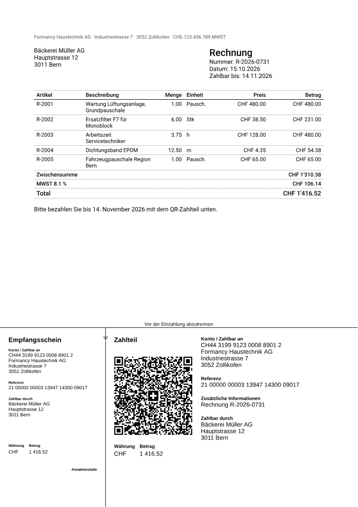
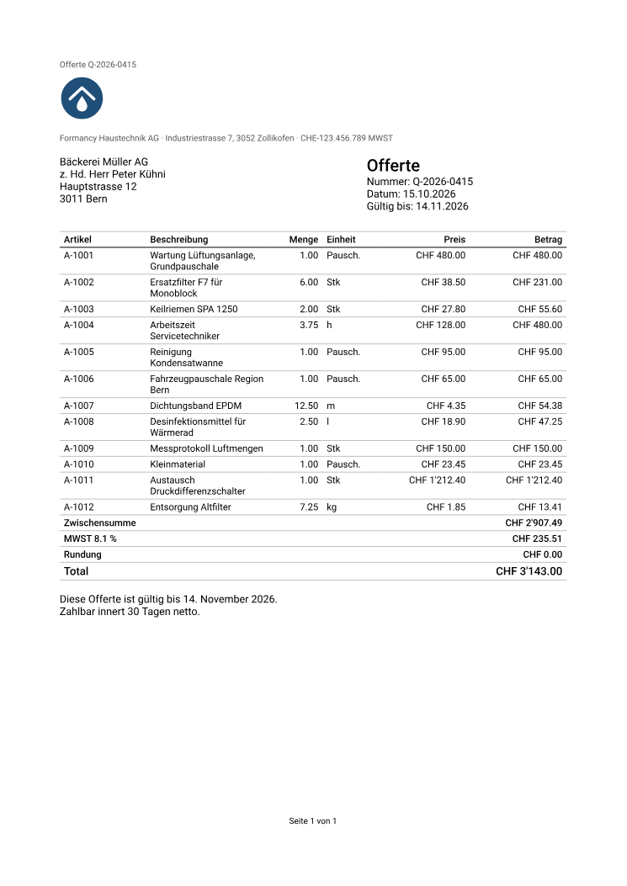
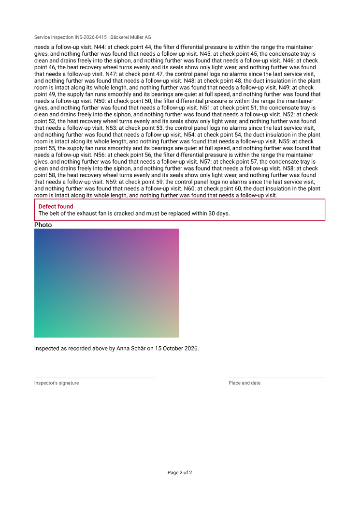
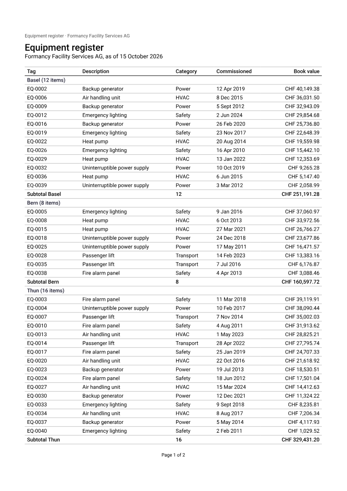
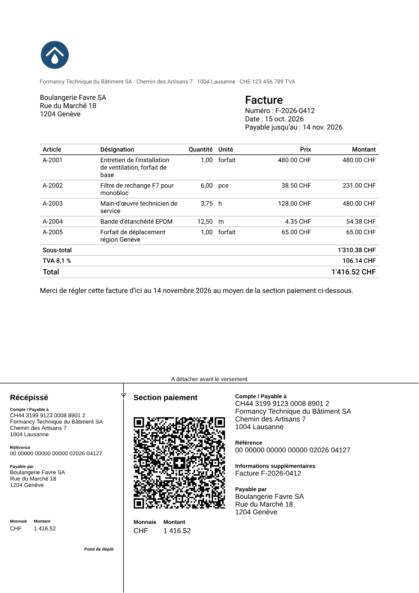
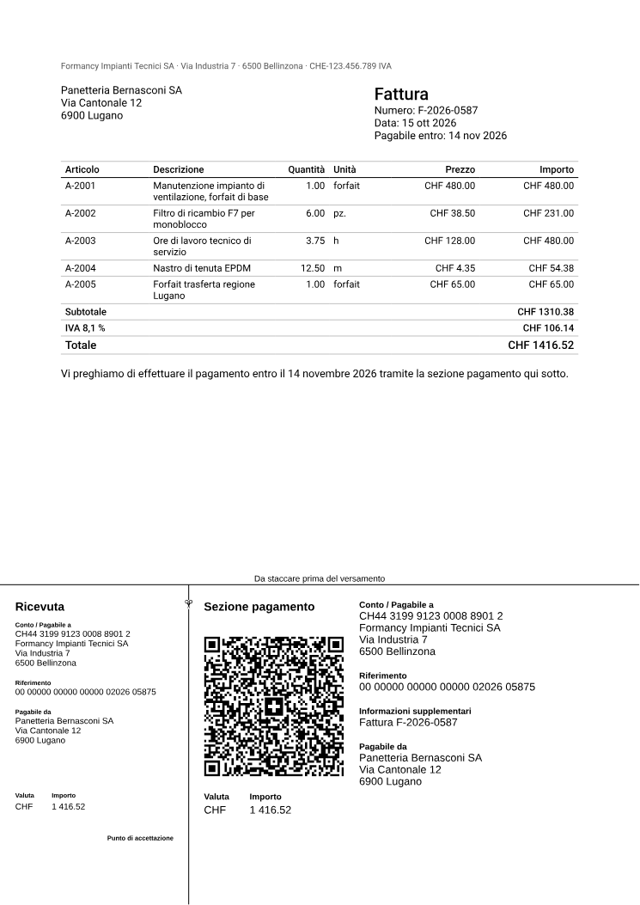
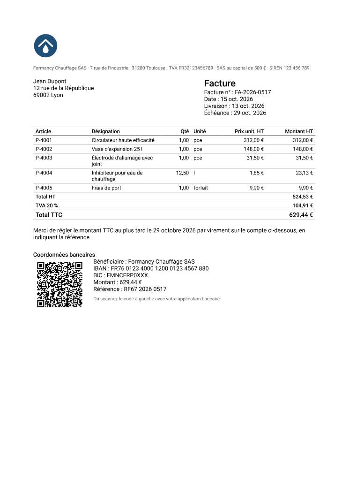
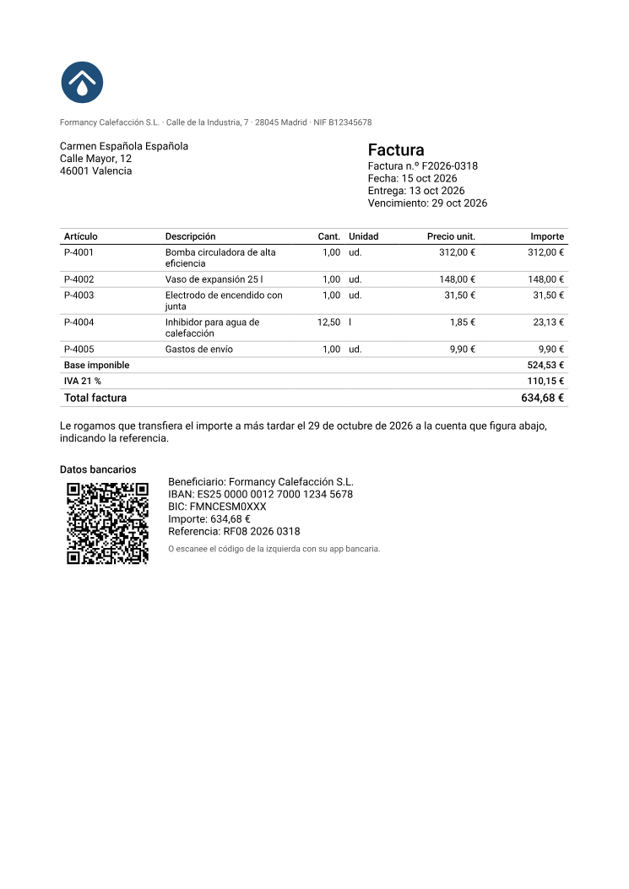
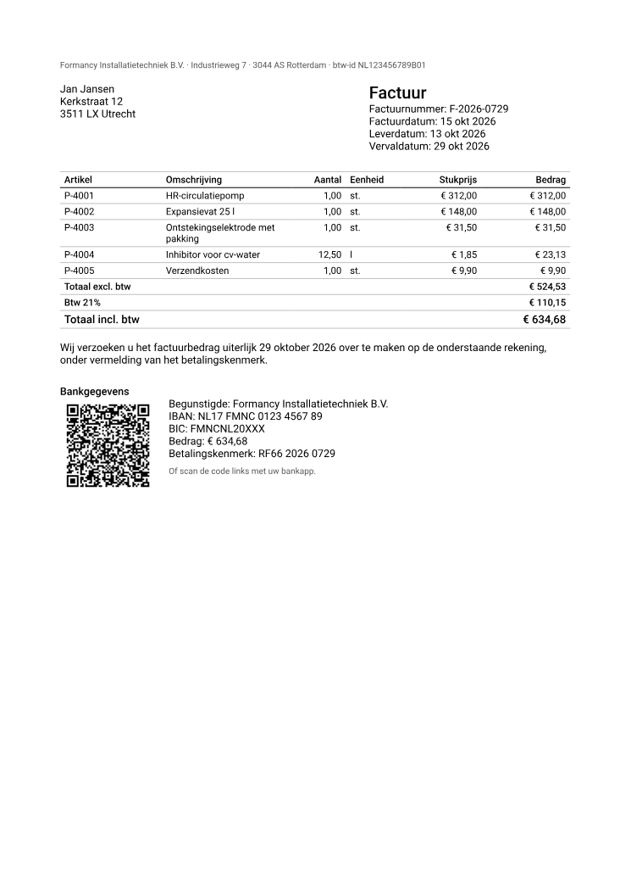
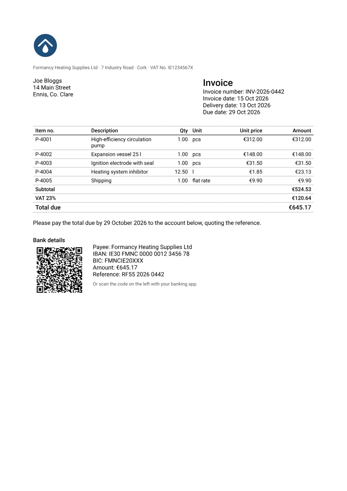

# What the starters print

Each starter's page, and each invoice sample's, printed from its synthetic
data by `@formancy/report-render-pdf` and drawn by PDF.js. Every firm,
customer and figure is invented, but for the standards' own examples: the
QR-bills pay SIX's example account, and the XRechnung's Leitweg-ID is
KoSIT's test one. Each starter's PDF and Word file are in [`samples/`](../samples/README.md).

`report-render-pdf`'s `pictures.test.ts` fails when a page stops printing
or drawing what its picture shows, or a caption here quotes what the page
does not print. It does not see a drawing changed inside its own box, a
rule, a border, an image or the colour of text
([0032](decisions/0032-the-invoices-and-the-quotation-print-one-invented-wordless-mark-at-the-top-left-of-their-first-page.md)).

## The starters

The e-invoice starter is the euro invoice's firm invoicing a German
business as an EN 16931 e-invoice: the page prints each total the XML
holds, computed once for both
([0027](decisions/0027-a-report-carries-one-en-16931-invoice-written-from-the-values-its-page-prints.md)).

![The XRechnung starter, the e-invoice's template in the other kind, an XRechnung 3.0 billing a German public buyer of its own, whose PDF is its copy: the page headed Copy of an XRechnung: the invoice is its XML, and this PDF is not the invoice, the Leitweg-ID: 991-33333TEST-33 at the foot of its head, its line items in euro, then Nettobetrag 535,00 €, Umsatzsteuer 19 % auf 535,00 € and Rechnungsbetrag 636,65 €, the totals its XML holds, and under them the Bankverbindung beside the EPC QR code that pays it](images/starter-e-invoice-xrechnung.png)

The XRechnung starter is the same template as an XRechnung 3.0 billing an
invented federal office by a Leitweg-ID from KoSIT's test suite: its XML
is the invoice, and its PDF a copy that says so on every page
([0038](decisions/0038-a-reports-e-invoice-may-be-an-xrechnung-3-0-whose-xml-a-host-takes-and-whose-pdf-is-its-labelled-copy.md),
[0065](decisions/0065-the-xrechnung-is-a-starter-beside-the-e-invoice-and-a-final-render-of-either-offers-its-xml-beside-its-pdf.md)).

The order confirmation prints one list of order lines as three tables,
each picking its lines by their kind and closing with its own total, the
order's total under them; each delivery's header is kept with its first
three lines, and page 1 prints the firm's letterhead in place of the
running header
([0059](decisions/0059-a-group-header-is-kept-on-its-page-with-as-many-of-its-groups-first-rows-as-the-report-states-or-as-fit.md),
[0060](decisions/0060-a-reports-first-page-may-print-a-header-of-its-own-or-none-in-place-of-the-page-header.md),
[0062](decisions/0062-a-report-holds-several-tables-over-its-detail-rows-each-printing-and-totalling-the-rows-its-condition-selects.md),
[0064](decisions/0064-an-order-confirmation-and-a-product-data-sheet-are-starters-that-print-what-0059-to-0063-added.md)).

![The payment reminder starter, a Mahnung under the firm's letterhead: the overdue invoices, each with its due date and its days overdue, down to Total überfällige Rechnungen CHF 4'773.65, the payments and the credit note received against them down to Total Zahlungen und Gutschriften CHF-1'586.35, each table totalling its own items, then Mahngebühr CHF 20.00 and Zu bezahlen CHF 3'207.30, and across the foot of the page its QR-bill, the Empfangsschein and the Zahlteil with its Swiss QR Code, each for CHF 3 207.30](images/starter-payment-reminder.png)

The payment reminder asks for the balance of a customer's overdue
invoices, the payments and the credit note received against them and its
fee, by a QR-bill whose headings follow the language the render prints in.
It pays SIX's example account, and no native speaker has reviewed its
French, Italian or English
([0066](decisions/0066-a-payment-reminder-is-a-starter-that-pays-the-balance-of-a-customers-overdue-invoices-by-a-qr-bill-in-the-customers-language.md)).

The product data sheet sets its units' powers, CO₂'s index and its
footnotes' marks as runs above and below the line, never as Unicode's
small digits, and is written in Swiss German with its words in French,
Italian and English; the board it describes and its values are invented,
and no native speaker has reviewed its French, Italian or English
([0061](decisions/0061-a-paragraphs-run-may-be-set-below-or-above-the-line-in-any-character-its-face-draws-and-prints-only-beside-a-run-on-the-line.md),
[0063](decisions/0063-a-reports-own-words-are-written-in-each-language-it-declares-and-a-render-names-the-one-it-prints-in.md)).

The euro invoice prints beside its EPC QR code what the code holds, for
the payer to compare with what the banking app read
([0025](decisions/0025-a-report-prints-an-epc-qr-code-held-to-the-epc-rules-beside-the-qr-bill.md)).

![The site visit starter, generated from version 2 of a formancy form: a line for each answer, from Objekt: Bahnhofplatz 1, 3011 Bern, the inspector, the ticked boxes and the matrix under their headings, Elektrik: [x] among them, the findings one table under Befunde, and the page counted, 1 / 1](images/starter-site-visit.png)

The site visit is the first draft `@formancy/report-forms` generates from a
formancy form version: its labels from that version, a group a section,
and a submission of that version read into it; its notes, which no page
shows, list what it left out and assumed
([0045](decisions/0045-a-report-generated-from-a-formancy-form-is-a-deterministic-first-draft-and-what-it-left-out-is-listed.md)).

## The invoice in four languages, and the euro invoice from six countries

The invoice comes in French, Italian and English too, the slip's headings
in SIX's words for each
([0024](decisions/0024-the-invoice-comes-in-four-languages-as-samples-and-a-qr-bill-page-shows-them.md)).

The euro invoice comes from Austria, France, Italy, Spain, the Netherlands
and Ireland, each selling parts for the boiler the starter services at the
country's standard VAT rate. No native speaker has reviewed their words,
and they do not print all that each country's invoicing law asks of an
invoice
([0028](decisions/0028-the-euro-invoice-comes-as-samples-from-six-euro-countries-and-an-epc-qr-code-page-shows-them.md)).

